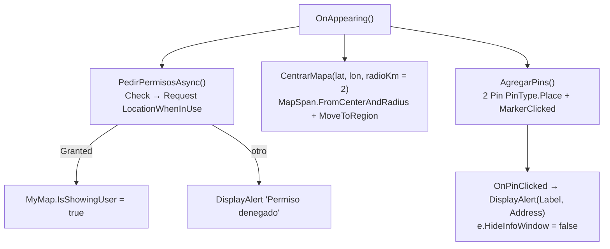

# 05 — Mapas

> **Propósito:** destilar el ejemplo de mapa nativo de .NET MAUI: control `Map`, pines, centrado por región, tipos de mapa, permisos de ubicación y cómo se provee la clave de Google en Android.
> **Fuentes primarias:** `Ejemplos_Devices/Maps/Ejemplo_Maui_Mapas/` (csproj, `MauiProgram.cs`, `Pages/MainPage.xaml(.cs)`, `Platforms/Android/AndroidManifest.xml`, `Platforms/iOS/Info.plist`), `Ejemplos_Devices/Maps/Ejemplo_Docs_Maps/Readme.md`, `Ejemplos_Devices/Ejemplos_Devices.slnx`. HEAD indexado: `cc80ce1`.
> **Fuera de alcance:** obtención de la posición GPS y geocodificación → [04_GPS](04_GPS.md); inyección de secretos en CI → [09_CI-CD-y-Build](09_CI-CD-y-Build.md).

## 1. Proyecto

| Dato | Valor | Cita |
|---|---|---|
| Proyecto | `Ejemplo_Maui_Mapas` (`ApplicationTitle` «Mapas») | `Ejemplos_Devices/Maps/Ejemplo_Maui_Mapas/Ejemplo_Maui_Mapas.csproj:15` |
| ApplicationId | `com.ejemplos.devices.mapas` | `…/Ejemplo_Maui_Mapas.csproj:17` |
| TFMs | `net10.0-android` siempre; `net10.0-ios` sólo en macOS; `net10.0-windows10.0.19041.0` sólo en Windows | `…/Ejemplo_Maui_Mapas.csproj:4-6` |
| Mínimos | iOS 15.0 · Android 25 · Windows 10.0.17763.0 | `…/Ejemplo_Maui_Mapas.csproj:24-27` |
| Paquetes | `Microsoft.Maui.Controls.Maps` **10.0.40** · `Microsoft.Maui.Controls` `$(MauiVersion)` · `Microsoft.Extensions.Logging.Debug` 10.0.2 | `…/Ejemplo_Maui_Mapas.csproj:77-79` |
| En la solución | sí, carpeta `/Ejemplos/Maps/` (+ `/Ejemplos/Maps/Docs/` con `Ejemplo_Docs_Maps/Readme.md`) | `Ejemplos_Devices/Ejemplos_Devices.slnx:73-80` |
| Arquitectura | Una sola página, todo en code-behind; sin MVVM, sin servicios ni DI propia | `…/Pages/MainPage.xaml.cs:6-98` |

```
Ejemplos_Devices/Maps/
├── Ejemplo_Maui_Mapas/
│   ├── MauiProgram.cs                 ← .UseMauiMaps()
│   ├── Pages/MainPage.xaml(.cs)       ← <maps:Map>, permisos, centrado, pines, tipo de mapa
│   ├── Platforms/Android/AndroidManifest.xml  ← meta-data API_KEY + permisos de ubicación
│   ├── Platforms/iOS/Info.plist       ← NSLocationWhenInUseUsageDescription
│   └── Readme.md                      ← enlace a la doc de Microsoft + nombre del NuGet
└── Ejemplo_Docs_Maps/Readme.md        ← vacío (0 líneas)
```

## 2. Registro y control `Map`

| Paso | Qué | Cita |
|---|---|---|
| Registro | `builder.UseMauiApp<App>().UseMauiMaps()` — sin esto no hay handler de mapa | `…/MauiProgram.cs:11-12` |
| Namespace XAML | `xmlns:maps="http://schemas.microsoft.com/dotnet/2021/maui/maps"` | `…/Pages/MainPage.xaml:4` |
| Control | `<maps:Map x:Name="MyMap" MapType="Street" IsShowingUser="False" IsScrollEnabled="True" IsZoomEnabled="True" />` | `…/Pages/MainPage.xaml:17-20` |
| Botones | «🗺 Normal» → `OnNormalClicked`, «🛰 Satélite» → `OnSateliteClicked`, «📍 Mi lugar» → `OnGoToLocation` | `…/Pages/MainPage.xaml:11-13` |
| `using` | `Microsoft.Maui.Controls.Maps` (Map, Pin) y `Microsoft.Maui.Maps` (MapSpan, Distance, MapType) | `…/Pages/MainPage.xaml.cs:1-2` |

## 3. Flujo de la página



`OnAppearing` es `async void` y encadena permisos → centrado → pines (`…/Pages/MainPage.xaml.cs:15-22`).

## 4. Centrado, pines y tipos de mapa

| Tema | API usada | Cita |
|---|---|---|
| Centrado inicial | `new Location(lat, lon)` → `MapSpan.FromCenterAndRadius(ubicacion, Distance.FromKilometers(radioKm))` → `MyMap.MoveToRegion(region)`; radio por defecto 2 km | `…/Pages/MainPage.xaml.cs:45-50` |
| Centrado alternativo (comentado) | `new MapSpan(centro, 0.1, 0.1)` — span en grados | `…/Pages/MainPage.xaml.cs:37-43` |
| «Mi lugar» | Mismo `FromCenterAndRadius` con una coordenada fija (no lee el GPS) | `…/Pages/MainPage.xaml.cs:91-97` |
| Pines | `new Pin { Label, Address, Location, Type = PinType.Place }`; se agregan con `MyMap.Pins.Add(pin)` | `…/Pages/MainPage.xaml.cs:52-77` |
| Tap en pin | `pin.MarkerClicked += OnPinClicked`; muestra alerta y deja el globo nativo con `e.HideInfoWindow = false` | `…/Pages/MainPage.xaml.cs:74`, `:79-85` |
| Tipo de mapa | `MyMap.MapType = MapType.Street` / `MapType.Satellite` | `…/Pages/MainPage.xaml.cs:87`, `:89` |
| Punto del usuario | `MyMap.IsShowingUser = true` sólo si el permiso fue concedido | `…/Pages/MainPage.xaml.cs:31-32` |

> ⚠️ El centro inicial y «Mi lugar» usan una coordenada de Entre Ríos (`-31.749788, -60.520532`, `…/Pages/MainPage.xaml.cs:20`, `:93`), mientras que los dos pines («Obelisco», «Casa Rosada») están en Buenos Aires (`…/Pages/MainPage.xaml.cs:60`, `:67`): con radio de 2 km, los pines quedan **fuera de la vista inicial**. Las `Address` («Calle 25», «Calle 33») son de relleno (`:59`, `:66`).
> ⚠️ `AgregarPins()` corre en cada `OnAppearing` (`…/Pages/MainPage.xaml.cs:21`) sin limpiar `MyMap.Pins`: si la página reaparece, los pines se duplican (lectura del código; no verificado en ejecución).

## 5. Clave de Google Maps (sin valores)

| Plataforma | Mecanismo | Cita |
|---|---|---|
| Android | `<meta-data android:name="com.google.android.geo.API_KEY" android:value="…"/>` dentro de `<application>`, más `com.google.android.gms.version` = `@integer/google_play_services_version` | `…/Platforms/Android/AndroidManifest.xml:9-14` |
| iOS | No hay clave: el `Info.plist` sólo declara el permiso de ubicación (MAUI usa MapKit en iOS) | `…/Platforms/iOS/Info.plist:32-33` |
| Windows | Ninguna configuración de mapa en el proyecto (soporte del control en Windows: no verificado) | `…/Platforms/Windows/Package.appxmanifest` (sin entradas de mapa) |

> ⚠️ **Clave literal versionada.** El `android:value` del `meta-data` de Android contiene una API key de Google en texto plano (valor **no reproducido**; `…/Platforms/Android/AndroidManifest.xml:10-11`). Contradice la decisión del repo de mantener secretos fuera de git (plantilla `ApiKeys.cs.template` + `secrets.GOOGLE_MAPS_API_KEY` en CI, que hoy sólo aplica a GPS → [04_GPS](04_GPS.md), [09_CI-CD-y-Build](09_CI-CD-y-Build.md); guía `Ejemplos_Devices/GPS/Ejemplo_Docs_GPS/secret.md`). Ya registrado como S-01 en el GAP-REPORT y en ADR 0007. Acción humana: rotar/restringir la clave y migrarla al mecanismo de plantilla. Para usar el ejemplo, reemplazar el valor por una clave propia (Maps SDK for Android).

## 6. Permisos

| Plataforma | Declaración | Uso | Cita |
|---|---|---|---|
| Android | `INTERNET`, `ACCESS_NETWORK_STATE` | Descarga de teselas | `…/Platforms/Android/AndroidManifest.xml:17-18` |
| Android | `ACCESS_FINE_LOCATION`, `ACCESS_COARSE_LOCATION` (comentados como «opcionales si querés mostrar la ubicación del usuario») | Punto azul | `…/Platforms/Android/AndroidManifest.xml:22-24` |
| Android | `minSdkVersion=25`, `targetSdkVersion=36` | — | `…/Platforms/Android/AndroidManifest.xml:26` |
| iOS | `NSLocationWhenInUseUsageDescription` = «Necesitamos tu ubicación para mostrarte en el mapa.» | Prompt de permiso | `…/Platforms/iOS/Info.plist:32-33` |
| Runtime | `Permissions.CheckStatusAsync<LocationWhenInUse>()` y, si no está concedido, `RequestAsync<LocationWhenInUse>()`; el mapa funciona igual sin permiso (sólo no muestra al usuario) | `…/Pages/MainPage.xaml.cs:24-35` |

## 7. Hallazgos ⚠️ (resumen)

| # | Hallazgo | Cita |
|---|---|---|
| 1 | API key de Google literal en el manifest de Android (valor no reproducido) | `…/Platforms/Android/AndroidManifest.xml:10-11` |
| 2 | Vista inicial (Entre Ríos) y pines (Buenos Aires) no coinciden; pines fuera de pantalla al abrir | `…/Pages/MainPage.xaml.cs:20`, `:60`, `:67` |
| 3 | Pines re-agregados en cada `OnAppearing` | `…/Pages/MainPage.xaml.cs:15-22`, `:72-76` |
| 4 | `Ejemplo_Docs_Maps/Readme.md` está vacío; lo poco que hay vive en `Ejemplo_Maui_Mapas/Readme.md` (enlace a la doc oficial y nombre del NuGet) | `Ejemplos_Devices/Maps/Ejemplo_Docs_Maps/Readme.md` (0 líneas) · `Ejemplos_Devices/Maps/Ejemplo_Maui_Mapas/Readme.md:2-5` |
| 5 | Existe una carpeta `Printer/Ejemplo_Docs_Maps/Borradores/` en la solución: el nombre sugiere Mapas pero pertenece a Impresión | `Ejemplos_Devices/Ejemplos_Devices.slnx:111` → [03_Impresion-Termica](03_Impresion-Termica.md) |

## 8. Fuentes

| Ruta | Qué contiene |
|---|---|
| `Ejemplos_Devices/Maps/Ejemplo_Maui_Mapas/Ejemplo_Maui_Mapas.csproj` | TFMs, mínimos de plataforma, paquete `Microsoft.Maui.Controls.Maps` |
| `Ejemplos_Devices/Maps/Ejemplo_Maui_Mapas/MauiProgram.cs` | `.UseMauiMaps()` |
| `Ejemplos_Devices/Maps/Ejemplo_Maui_Mapas/Pages/MainPage.xaml` | Control `<maps:Map>` y botones |
| `Ejemplos_Devices/Maps/Ejemplo_Maui_Mapas/Pages/MainPage.xaml.cs` | Permisos, centrado, pines, tipo de mapa |
| `Ejemplos_Devices/Maps/Ejemplo_Maui_Mapas/Platforms/Android/AndroidManifest.xml` | `meta-data` de la clave y Play Services, permisos |
| `Ejemplos_Devices/Maps/Ejemplo_Maui_Mapas/Platforms/iOS/Info.plist` | Texto del permiso de ubicación |
| `Ejemplos_Devices/Maps/Ejemplo_Maui_Mapas/Readme.md` | Enlace a la doc de Microsoft del control Map |
| `Ejemplos_Devices/Maps/Ejemplo_Docs_Maps/Readme.md` | Vacío |
| `Ejemplos_Devices/GPS/Ejemplo_Docs_GPS/secret.md` | Mecanismo de secretos del repo (aplicado en GPS) |

## 9. Prosa relacionada

| Documento | Qué aporta |
|---|---|
| [Pieza Maps](../../Ejemplos_Maui_Devices-docs/docs/pieces/maps/README.md) | Explicación narrada, cómo obtener y restringir una clave propia, diferencias por plataforma, preguntas guía |
| [ADR 0007 — secretos fuera del repo](../../Ejemplos_Maui_Devices-docs/docs/04-decisions/0007-secretos-fuera-del-repo.md) | Decisión plantilla + secrets; registra la deriva de la clave de Maps |
| [GAP-REPORT](../../Ejemplos_Maui_Devices-docs/GAP-REPORT.md) | Hallazgo S-01 (clave versionada) |
