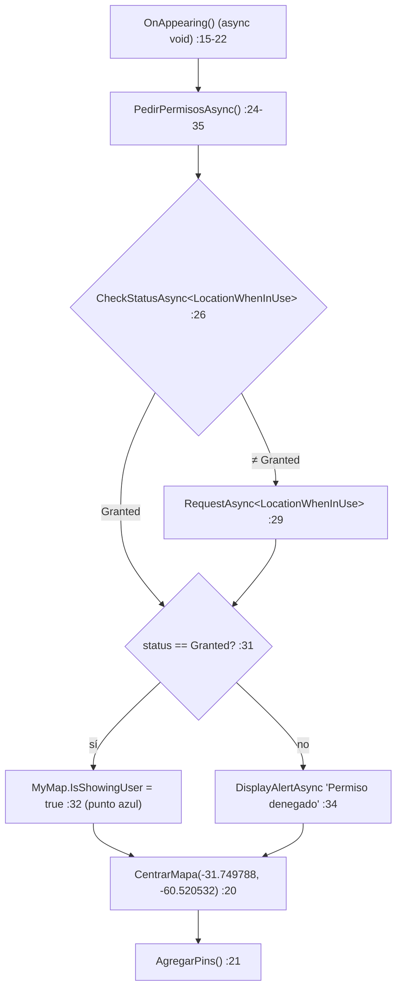

# 05 — Mapas

> **Propósito**: destilar el ejemplo del control `Map` nativo de .NET MAUI (`Microsoft.Maui.Controls.Maps`): registro con `UseMauiMaps()`, permiso de ubicación, centrado por región, pines, tipos de mapa, clave de Google Maps por plataforma y targets (TFM) de Windows/iOS.
> **Fuente primaria**: `Ejemplos_Devices/Maps/Ejemplo_Maui_Mapas/**` y `Ejemplos_Devices/Maps/Ejemplo_Docs_Maps/Readme.md` (repo de código, commit `285f6fb`).
> **Índices relacionados**: [00_MASTER-INDEX](00_MASTER-INDEX.md) · [04_GPS](04_GPS.md) (geocodificación, `ApiKeys` y guía de secretos) · [09_CI-CD-y-Build](09_CI-CD-y-Build.md) (solución, workflows, firma) · [10_Documentacion-Transversal](10_Documentacion-Transversal.md) (README raíz y prosa).

Rutas relativas a la raíz del repo de código. Abreviatura: `M/` = `Ejemplos_Devices/Maps/Ejemplo_Maui_Mapas/`.

---

## 1. Qué es y qué ilustra

Un único proyecto MAUI, sin MVVM ni servicios: **toda la lógica vive en el code-behind** de una sola página (`M/Pages/MainPage.xaml.cs`). Es deliberadamente mínimo; no sigue el patrón «servicio → resultado tipado → overlay» del resto de la colección (ver [00_MASTER-INDEX](00_MASTER-INDEX.md)).

| Concepto MAUI | Dónde | Línea |
|---|---|---|
| Paquete `Microsoft.Maui.Controls.Maps` 10.0.40 | `M/Ejemplo_Maui_Mapas.csproj` | 79 |
| Registro de handlers `.UseMauiMaps()` | `M/MauiProgram.cs` | 12 |
| Namespace XAML `maps` + control `<maps:Map>` | `M/Pages/MainPage.xaml` | 4, 17-20 |
| Permiso `Permissions.LocationWhenInUse` → `IsShowingUser` | `M/Pages/MainPage.xaml.cs` | 24-35 |
| Centrado `MapSpan.FromCenterAndRadius` + `MoveToRegion` | `M/Pages/MainPage.xaml.cs` | 45-50 |
| Pines `Pin` + `MarkerClicked` | `M/Pages/MainPage.xaml.cs` | 52-85 |
| Cambio de `MapType` (Street / Satellite) | `M/Pages/MainPage.xaml.cs` | 87-89 |
| API key de Google Maps (Android) | `M/Platforms/Android/AndroidManifest.xml` | 9-11 |
| Texto de permiso iOS | `M/Platforms/iOS/Info.plist` | 32-33 |

---

## 2. Inventario de archivos

```
Ejemplos_Devices/Maps/
├── Ejemplo_Docs_Maps/
│   └── Readme.md                 ← ⚠️ vacío (0 bytes); el README raíz lo enlaza (§9)
└── Ejemplo_Maui_Mapas/
    ├── Ejemplo_Maui_Mapas.csproj ← TFMs, ApplicationId, paquete Maps (§3)
    ├── Readme.md                 ← sólo un link a learn.microsoft.com + nombre del NuGet
    ├── MauiProgram.cs            ← UseMauiMaps() (§4)
    ├── App.xaml(.cs)             ← plantilla: Window(new AppShell())
    ├── AppShell.xaml(.cs)        ← un único ShellContent → pages:MainPage, Route "MainPage"
    ├── Pages/MainPage.xaml(.cs)  ← UI + toda la lógica (§5–§7)
    ├── Properties/launchSettings.json ← sólo perfil "Windows Machine"
    ├── Platforms/Android/        ← AndroidManifest (key + permisos), MainActivity, MainApplication
    ├── Platforms/iOS/            ← Info.plist (NSLocationWhenInUse…), AppDelegate, Program, PrivacyInfo
    └── Platforms/Windows/        ← plantilla WinUI (App.xaml, Package.appxmanifest, app.manifest)
```

No hay `Platforms/MacCatalyst/` ni TFM `maccatalyst` (`M/Ejemplo_Maui_Mapas.csproj:4-6`). Recursos (`Resources/**`) son los de la plantilla MAUI (fuentes OpenSans, `dotnet_bot.png`, estilos).

---

## 3. Proyecto (`.csproj`)

| Propiedad | Valor | Línea |
|---|---|---|
| `TargetFrameworks` base | `net10.0-android` | 4 |
| + iOS | `net10.0-ios` **sólo si el host es macOS** | 5 |
| + Windows | `net10.0-windows10.0.19041.0` **sólo si el host es Windows** (único `.csproj` del repo con TFM Windows) | 6 |
| `ApplicationTitle` / `ApplicationId` | `Mapas` / `com.ejemplos.devices.mapas` | 15, 17 |
| `WindowsPackageType` | `None` (WinUI sin empaquetar) | 22 |
| `SupportedOSPlatformVersion` | iOS 15.0 · Android 25.0 · Windows 10.0.17763.0 | 24-26 |
| Android: `AndroidLdFlags` | `-Wl,-z,max-page-size=16384` (páginas de 16 KB) | 33 |
| Android: `RuntimeIdentifiers` | `android-arm;android-arm64;android-x86;android-x64` | 34 |
| Android Release/Debug | `apk`, `AndroidUseAapt2`, sin APK por ABI; Debug con `EmbedAssembliesIntoApk` | 37-49 |
| iOS Release | `UseInterpreter`, `PublishTrimmed`, `MtouchLink=SdkOnly`, AOT sólo `ios-arm64` | 53-63 |
| Paquetes | `Microsoft.Maui.Controls` `$(MauiVersion)` · `Microsoft.Extensions.Logging.Debug` 10.0.2 · `Microsoft.Maui.Controls.Maps` **10.0.40** | 77-79 |

- ⚠️ `Microsoft.Maui.Controls.Maps` va con versión fija (10.0.40) mientras `Microsoft.Maui.Controls` toma `$(MauiVersion)` del workload instalado (`M/Ejemplo_Maui_Mapas.csproj:77,79`). No hay `Directory.Build.props`/`Directory.Packages.props` versionado en el repo que unifique ambas. Si el workload difiere de 10.0.40 pueden convivir dos versiones de MAUI (efecto real **no verificado**).
- Las propiedades de Android/iOS son el bloque compartido por los proyectos de la colección; su razón de ser (firma, artefactos, simulador) está en [09_CI-CD-y-Build](09_CI-CD-y-Build.md).

---

## 4. Arranque: `UseMauiMaps()`

```
MauiProgram.CreateMauiApp()            M/MauiProgram.cs:7-24
  └─ builder.UseMauiApp<App>()          :11
       .UseMauiMaps()                    :12  ← registra los handlers de Map/Pin
       .ConfigureFonts(...)              :13-17
  └─ #if DEBUG Logging.AddDebug()        :19-21
App() → CreateWindow → new Window(new AppShell())   M/App.xaml.cs:12-15
AppShell → ShellContent Route="MainPage"            M/AppShell.xaml:10-13
```

- No hay inyección de dependencias: `MainPage` se instancia por `DataTemplate` en Shell y no recibe servicios (`M/AppShell.xaml:12`).
- Sin `.UseMauiMaps()` el `<maps:Map>` no tiene handler nativo (comportamiento documentado de MAUI; en el repo sólo consta la llamada).

---

## 5. La página: XAML

`M/Pages/MainPage.xaml`

```
Grid RowDefinitions="Auto,*" Margin=10                         :7
├─ Row 0: HorizontalStackLayout (Spacing 10, Padding 10)       :10-14
│   ├─ Button "🗺 Normal"    → OnNormalClicked                 :11
│   ├─ Button "🛰 Satélite"  → OnSateliteClicked               :12
│   └─ Button "📍 Mi lugar"  → OnGoToLocation                  :13
└─ Row 1: maps:Map x:Name="MyMap"                              :17-20
        MapType="Street" IsShowingUser="False"
        IsScrollEnabled="True" IsZoomEnabled="True"
```

- Namespace: `xmlns:maps="http://schemas.microsoft.com/dotnet/2021/maui/maps"` (`:4`).
- `IsShowingUser` arranca en `False` a propósito: se enciende en código sólo si el permiso se concede (§6).
- Sin bindings ni `x:DataType`; los eventos son `Clicked` directos al code-behind.

---

## 6. Ciclo de `OnAppearing` y permisos

`M/Pages/MainPage.xaml.cs`



| Paso | Detalle | Línea |
|---|---|---|
| Chequeo | `Permissions.CheckStatusAsync<Permissions.LocationWhenInUse>()` | 26 |
| Pedido | sólo si no está concedido | 28-29 |
| Éxito | `MyMap.IsShowingUser = true` | 32 |
| Rechazo | alerta «No se puede mostrar tu ubicación.»; la página **sigue** (degradación, no bloqueo) | 34 |

- El mapa no lee la posición GPS del usuario: sólo delega en el control nativo el «punto azul». Lectura de ubicación con `Geolocation` → [04_GPS](04_GPS.md).
- ⚠️ `OnAppearing` es `async void` y no tiene `try/catch` (`:15-22`): una excepción en `PedirPermisosAsync` no se captura en la página.
- ⚠️ `OnAppearing` vuelve a correr cada vez que la página reaparece, y `AgregarPins()` agrega pines nuevos sin limpiar `MyMap.Pins` (`:72-76`): en una reaparición se duplicarían. Con una sola página en Shell el caso es raro; **no verificado** en ejecución.

---

## 7. Centrado, pines y tipo de mapa

### 7.1 Centrado por región

| Método | Qué hace | Línea |
|---|---|---|
| `CentrarMapa(lat, lon, radioKm = 2)` | `new Location` → `MapSpan.FromCenterAndRadius(…, Distance.FromKilometers(radioKm))` → `MyMap.MoveToRegion` | 45-50 |
| `CentrarMapa()` comentado («Buenos Aires») | versión previa con `new MapSpan(centro, 0.1, 0.1)` en **grados** | 37-43 |
| `OnGoToLocation` (botón «📍 Mi lugar») | repite inline el mismo `FromCenterAndRadius` a `(-31.749788, -60.520532)` radio 2 km | 91-97 |

Contraste didáctico: `MapSpan(centro, latDeg, lonDeg)` (span en grados, comentado) vs `MapSpan.FromCenterAndRadius(centro, Distance)` (radio en km, vigente).

- ⚠️ «Mi lugar» **no** usa la ubicación del dispositivo: mueve a la coordenada fija del código, la misma que `OnAppearing` (`:20` y `:93`). El nombre del botón sugiere otra cosa.
- La coordenada `(-31.749788, -60.520532)` no tiene etiqueta en el código; la versión anterior de este índice la daba como Paraná (Entre Ríos), pero el repo no lo dice: **no verificado**.
- `OnGoToLocation` duplica la lógica de `CentrarMapa` en lugar de llamarla: es deliberado/didáctico, no un defecto a corregir.

### 7.2 Pines

| Pin | `Label` | `Address` | `Location` | `Type` | Línea |
|---|---|---|---|---|---|
| 1 | `Obelisco` | `Calle 25` | `(-34.6037, -58.3816)` | `PinType.Place` | 56-62 |
| 2 | `Casa Rosada` | `Calle 33` | `(-34.6083, -58.3712)` | `PinType.Place` | 63-69 |

```
foreach pin → pin.MarkerClicked += OnPinClicked; MyMap.Pins.Add(pin)   :72-76
OnPinClicked (async void) :79-85
  ├─ if sender is Pin → DisplayAlertAsync("📍 Pin", "{Label}\n{Address}")  :81-82
  └─ e.HideInfoWindow = false   // "muestra el tooltip nativo"            :84
```

- ⚠️ Los pines están en Buenos Aires (lat ≈ -34.60) pero el mapa se centra en lat ≈ -31.75 con radio 2 km (`:20`, `:60`, `:67`): **al abrir, ningún pin queda en pantalla**; hay que desplazarse/alejar el zoom para verlos.
- ⚠️ Las direcciones `Calle 25` / `Calle 33` son de relleno, no las reales de esos lugares (`:59`, `:66`).
- ⚠️ `e.HideInfoWindow = false` se asigna **después** del `await` de la alerta (`:82-84`). Como el handler es `async void`, el control recupera el control en el primer `await`, antes de esa asignación; si el flag se lee al retornar, la línea no tendría efecto. Además `false` podría ser ya el valor por defecto. Ambas cosas: **no verificado** (dependen de la implementación del handler de MAUI, no del repo).

### 7.3 Tipo de mapa

| Botón | Handler | Efecto | Línea |
|---|---|---|---|
| 🗺 Normal | `OnNormalClicked` | `MyMap.MapType = MapType.Street` | 87 |
| 🛰 Satélite | `OnSateliteClicked` | `MyMap.MapType = MapType.Satellite` | 89 |

`MapType.Hybrid` existe en la API pero el ejemplo no lo usa. Valor inicial `Street` desde XAML (`M/Pages/MainPage.xaml:17`).

### 7.4 Gestos y propiedades del control

| Propiedad | Valor | Dónde |
|---|---|---|
| `IsScrollEnabled` | `True` | `M/Pages/MainPage.xaml:19` |
| `IsZoomEnabled` | `True` | `M/Pages/MainPage.xaml:20` |
| `IsShowingUser` | `False` → `true` si hay permiso | `M/Pages/MainPage.xaml:18` / `M/Pages/MainPage.xaml.cs:32` |
| `IsTrafficEnabled`, `MapElements`, `MapClicked`, `VisibleRegion` | no usados | — |

---

## 8. Configuración por plataforma

### 8.1 Android — `M/Platforms/Android/AndroidManifest.xml`

| Elemento | Valor / rol | Línea |
|---|---|---|
| `meta-data com.google.android.geo.API_KEY` | key de Google Maps **literal** (valor no reproducido aquí) | 9-11 |
| `meta-data com.google.android.gms.version` | `@integer/google_play_services_version` | 13-14 |
| `INTERNET`, `ACCESS_NETWORK_STATE` | descarga de tiles | 17-18 |
| `ACCESS_FINE_LOCATION`, `ACCESS_COARSE_LOCATION` | comentario: «Permisos opcionales si querés mostrar la ubicación del usuario» | 22-24 |
| `uses-sdk` | `minSdkVersion=25`, `targetSdkVersion=36` | 26 |

- En Android el control usa Google Maps SDK: sin key válida no se ven los tiles (comportamiento documentado de MAUI/Google; la key del repo no se probó).
- ⚠️ **La API key está hardcodeada y versionada** en el manifest (`:10-11`), a contramano del mecanismo plantilla + secretos que el propio repo documenta para GPS (`Ejemplos_Devices/GPS/Ejemplo_Docs_GPS/secret.md`, `ApiKeys.cs.template`) → ver [04_GPS](04_GPS.md). El repo de documentación lo registra como hallazgo S-01 (`Ejemplos_Maui_Devices-docs/GAP-REPORT.md:59`) y lo vincula a `Ejemplos_Maui_Devices-docs/docs/04-decisions/0007-secretos-fuera-del-repo.md` (ADR-0007; rutas del repo de documentación).
- La key de Maps en el manifest **no** pasa por `ApiKeys.cs`: el único `sed` activo con `secrets.GOOGLE_MAPS_API_KEY` está en `.github/workflows/cd-ios-gps.Ejemplo_GPS.yml:279-284` y genera `Services/ApiKeys.cs` del GPS; en los demás workflows esa línea está comentada. Ninguno toca este manifest → [09_CI-CD-y-Build](09_CI-CD-y-Build.md).
- Rotar la key implica editar el manifest a mano.
- `MainActivity` / `MainApplication` son de plantilla, sin código de mapas (`M/Platforms/Android/MainActivity.cs:7-10`, `MainApplication.cs:6-15`).

### 8.2 iOS — `M/Platforms/iOS/Info.plist`

| Clave | Valor | Línea |
|---|---|---|
| `NSLocationWhenInUseUsageDescription` | «Necesitamos tu ubicación para mostrarte en el mapa.» | 32-33 |
| `UIRequiredDeviceCapabilities` | `arm64` | 12-15 |

- En iOS el control usa MapKit y **no requiere API key** (no hay ninguna en `Info.plist`). Sin la clave `NSLocationWhenInUseUsageDescription`, el pedido de permiso de `:29` no puede mostrarse.
- `PrivacyInfo.xcprivacy` es el manifiesto mínimo de plantilla MAUI (FileTimestamp, SystemBootTime, DiskSpace, UserDefaults), sin entradas de ubicación (`M/Platforms/iOS/Resources/PrivacyInfo.xcprivacy`).
- El TFM iOS sólo se agrega compilando en macOS (`M/Ejemplo_Maui_Mapas.csproj:5`).

### 8.3 Windows — TFM `net10.0-windows10.0.19041.0`

| Aspecto | Estado | Fuente |
|---|---|---|
| TFM | sólo si el host es Windows | `M/Ejemplo_Maui_Mapas.csproj:6` |
| Empaquetado | `WindowsPackageType=None` (unpackaged) | `M/Ejemplo_Maui_Mapas.csproj:22` |
| `Package.appxmanifest` | placeholders de plantilla, capacidad `runFullTrust`, **sin** `location` | `M/Platforms/Windows/Package.appxmanifest:9-44` |
| `launchSettings.json` | único perfil `Windows Machine` | `M/Properties/launchSettings.json:3-6` |
| Token/clave de mapas | ninguno configurado | — |

- ⚠️ El target Windows compila, pero `Microsoft.Maui.Controls.Maps` no trae implementación para Windows según la documentación de Microsoft (**no verificado** en el repo): el `<maps:Map>` no mostraría un mapa allí. El único perfil de `launchSettings.json` es justamente Windows, lo que puede inducir a lanzar el ejemplo en la plataforma donde no funciona.

### 8.4 Resumen por plataforma

| | Android | iOS | Windows |
|---|---|---|---|
| Motor | Google Maps SDK | MapKit | sin soporte (no verificado) |
| API key | sí, en manifest | no | — |
| Permiso de ubicación | manifest `:23-24` + runtime | `Info.plist:32-33` + runtime | no declarado |
| TFM siempre presente | sí | sólo host macOS | sólo host Windows |

---

## 9. Documentación del dominio

| Archivo | Contenido real |
|---|---|
| `Ejemplos_Devices/Maps/Ejemplo_Docs_Maps/Readme.md` | **vacío** (0 bytes) |
| `M/Readme.md` | link a `learn.microsoft.com/es-es/dotnet/maui/user-interface/controls/map?view=net-maui-10.0` (`:2`) y la palabra `Microsoft.Maui.Controls.Maps` (`:4-5`) |
| `README.md` (raíz) | sección «📄[Maps]» → `Ejemplo_Docs_Maps/Readme.md`, «En construcción ...» (`:23-24`) |

- ⚠️ El README raíz enlaza al Readme vacío; el poco contenido existente está en el Readme del proyecto. Es coherente con el estado «en construcción»; mapa general de la prosa en [10_Documentacion-Transversal](10_Documentacion-Transversal.md).
- Prosa extendida (repo de documentación): `Ejemplos_Maui_Devices-docs/docs/pieces/maps/README.md` (pieza `PIECE-MAP-001`, status `draft`), con flujo, tabla de permisos y snippets.

---

## 10. Solución, CI e historia

| Aspecto | Dato | Fuente |
|---|---|---|
| Carpeta en la solución | `/Ejemplos/Maps/` con `<Deploy />`; `/Ejemplos/Maps/Docs/` con el Readme | `Ejemplos_Devices/Ejemplos_Devices.slnx:73-80` |
| Workflow propio | **ninguno** (no hay `.github/workflows/*` que mencione `Mapas`/`Maps/`) | `ls .github/workflows` |
| Commits que tocaron `Ejemplos_Devices/Maps` | `3a85bda` (2026-02-23) · `16083d3` (2026-02-28, «docs») · `f7c1099` (2026-05-15, «probando comipilar todo») | `git log -- Ejemplos_Devices/Maps` |

- ⚠️ En `Ejemplos_Devices.slnx:111` aparece `Printer/Ejemplo_Docs_Maps/Borradores/Readme.md` (carpeta de solución `/Ejemplos/Printer/Docs/Ejemplo_ThermalPrinter/Borradores/`): pese al nombre, cuelga de `Printer/`, no pertenece a este dominio y **el archivo no existe** en el repo (`git ls-files` no lo lista) → [03_Impresion-Termica](03_Impresion-Termica.md).
- Build y despliegue general → [09_CI-CD-y-Build](09_CI-CD-y-Build.md).

---

## 11. Relación con GPS (frontera)

| Tema | Va en |
|---|---|
| Control `Map` nativo, pines, `MapSpan`, `MapType` | este índice |
| `Geolocation`, coordinador de GPS, overlay | [04_GPS](04_GPS.md) |
| Geocodificación HTTP (`GoogleMapService`, `maps.googleapis.com/maps/api/geocode/json`) | [04_GPS](04_GPS.md) |
| Abrir Google Maps externo por URL (`maps.google.com/?q=`) | [04_GPS](04_GPS.md) |
| `ApiKeys.cs.template` + `secret.md` + secret `GOOGLE_MAPS_API_KEY` | [04_GPS](04_GPS.md) / [09_CI-CD-y-Build](09_CI-CD-y-Build.md) |

Este ejemplo **no** comparte código con GPS: no referencia `GoogleMapService` ni `ApiKeys`.

---

## 12. Preguntas frecuentes y trampas

| Pregunta | Respuesta | § |
|---|---|---|
| ¿Qué hace falta para usar `Map`? | NuGet `Microsoft.Maui.Controls.Maps` + `.UseMauiMaps()` + `xmlns:maps` | §3, §4, §5 |
| ¿Dónde va la key de Google Maps? | Android: `meta-data com.google.android.geo.API_KEY` en el manifest. iOS no usa key | §8.1, §8.2 |
| ¿La key del repo sirve para mi app? | No la uses: está versionada (hallazgo S-01); generá la tuya restringida al package `com.ejemplos.devices.mapas` | §8.1 |
| ¿Por qué no veo los pines al abrir? | Están en Buenos Aires y el mapa se centra a 2 km de otra coordenada | §7.2 |
| ¿«Mi lugar» me lleva a mi posición? | No: coordenada fija del código | §7.1 |
| ¿El mapa funciona sin permiso de ubicación? | Sí; sólo falta el punto azul | §6 |
| ¿Corre en Windows? | Compila (host Windows), pero no hay mapa en Windows (no verificado) | §8.3 |
| ¿Hay MacCatalyst? | No | §2 |
| ¿Se construye en CI? | No hay workflow para este proyecto | §10 |
| ¿Dónde está la documentación? | `Ejemplo_Docs_Maps/Readme.md` vacío; contenido mínimo en `M/Readme.md` | §9 |
| ¿Span en grados o en km? | Vigente: `FromCenterAndRadius` (km); comentado: `new MapSpan(…, 0.1, 0.1)` (grados) | §7.1 |
