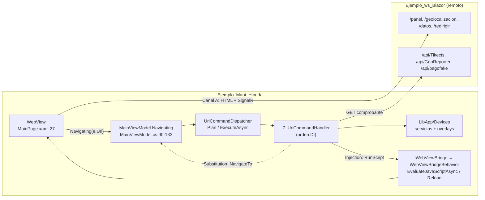
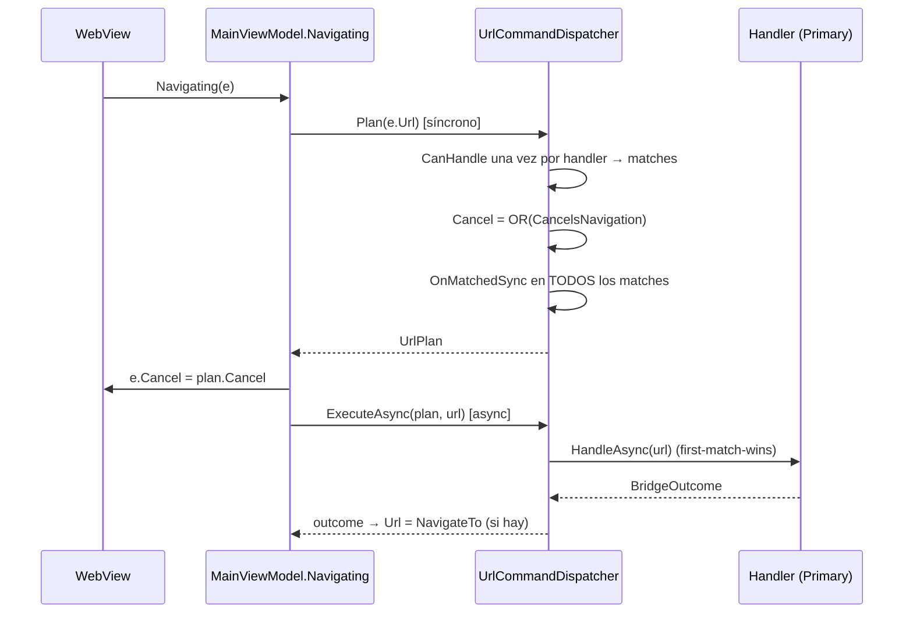

# 08 — App híbrida integrada (WebView + Blazor + puente de comandos por URL)

> **Propósito**: ubicar en el código todo lo que hace funcionar la app híbrida `Ejemplo_Maui_Hibrida`: el `WebView` sobre la web Blazor Server remota, el puente de comandos por URL (clasificación, cancelación, ejecución y vuelta del resultado al DOM), los overlays de estado, el backend `Ejemplo_ws_Blazor`, los trust anchors TLS y la suite xUnit. El porqué de cada decisión vive en la prosa y los ADR enlazados en «Ver también»; este índice dice *dónde está*.
>
> **Fuente primaria**: repo de código `Ejemplos_Maui_Devices` en HEAD `cc80ce1`, carpeta `Ejemplos_Devices/Integrada/`. **Todas las rutas de código de este índice son relativas a esa carpeta** (`Ejemplo_Maui_Hibrida/…`, `Ejemplo_Maui_Hibrida.Tests/…`, `Ejemplo_ws_Blazor/…`, `Ejemplo_Docs_Integrada/…`). Refleja los cuatro commits de la híbrida más recientes: `0ef370b` (clasificación separada de la ejecución, «Plan 1»), `285f6fb` (panel con ambos modos de GPS, namespaces `LibApp.*`), `85384c2` y `cc80ce1` (mayúsculas de rutas en `.slnx` y en un enlace de `Docs/web-hibrida`). La CI y el build están en [09_CI-CD-y-Build.md](09_CI-CD-y-Build.md).

---

## 1. Mapa de la carpeta `Integrada/`

```text
Integrada/
├── Ejemplo_Maui_Hibrida/                 app MAUI (net10.0-android; +net10.0-ios sólo en macOS)
│   ├── MauiProgram.cs                    DI: servicios, overlays, handlers (el orden = prioridad)
│   ├── App.xaml(.cs) · AppShell.xaml(.cs) ventana con Shell; rutas de cámara/selfie/QR
│   ├── Pages/MainPage.xaml(.cs)          WebView + 4 overlays + botonera nativa; URL inicial
│   ├── ViewModels/MainViewModel.cs       intercepta Navigating/Navigated; botones nativos
│   ├── LibApp/
│   │   ├── UrlCommands/                  contrato, plan, entrega, dispatcher (platform-free)
│   │   │   └── Handlers/                 7 handlers (GPS, llamada, foto, selfie, QR, sendAPI, print)
│   │   ├── CustomWebView/                IWebViewBridge + behavior + converters de eventos
│   │   └── Devices/                      Common · GPS · Camera · Images · QRLector · Phone · Networks · MotorDSL
│   ├── Platforms/Android/…               manifest, network_security_config, raw/*.pem (anclas TLS)
│   └── Platforms/iOS/…                   Info.plist, entitlements, PrivacyInfo
├── Ejemplo_Maui_Hibrida.Tests/           xUnit net10.0 que LINKEA fuentes de la app (sin ProjectReference)
├── Ejemplo_ws_Blazor/                    web Blazor Interactive Server + API REST + OpenAPI/Scalar
└── Ejemplo_Docs_Integrada/Readme.md      vacío (0 líneas); figura en el .slnx (Ejemplos_Devices.slnx:70-72)
```

Detalle de cada servicio de dispositivo: índices de dominio ([01_Camara.md](01_Camara.md), [02_QR.md](02_QR.md), [03_Impresion-Termica.md](03_Impresion-Termica.md), [04_GPS.md](04_GPS.md), [06_Telefonia.md](06_Telefonia.md), [07_Red-Conectividad.md](07_Red-Conectividad.md)). Aquí sólo se cubre cómo la híbrida los orquesta.

---

## 2. Arquitectura: WebView estándar sobre Blazor Server remoto

| Aspecto | Dónde | Hecho |
|---|---|---|
| Control | `Ejemplo_Maui_Hibrida/Pages/MainPage.xaml:27` | `WebView` estándar de MAUI (no `BlazorWebView`), `Source="{Binding Url}"` |
| URL inicial | `Ejemplo_Maui_Hibrida/Pages/MainPage.xaml.cs:17` | `mainViewModel.Url = "https://aplicada.somee.com"`; alternativas comentadas en `:13-15` (otro host somee, Google, dev tunnel) |
| Botón «Volver» | `Ejemplo_Maui_Hibrida/ViewModels/MainViewModel.cs:146-150` | Reasigna la misma URL fija |
| Interactividad de la web | `Ejemplo_ws_Blazor/Program.cs:8,57` | `AddInteractiveServerComponents` + `AddInteractiveServerRenderMode`: circuito SignalR («Canal A») |
| Acceso a dispositivos | `Ejemplo_Maui_Hibrida/Pages/MainPage.xaml:31-37` | `EventToCommandBehavior` de `Navigating`/`Navigated` → `MainViewModel` («Canal B») |
| Vuelta al DOM | `Ejemplo_Maui_Hibrida/Pages/MainPage.xaml:29` | `WebViewBridgeBehavior Bridge="{Binding WebBridge}"` |
| Pull-to-refresh | `Ejemplo_Maui_Hibrida/Pages/MainPage.xaml:24-26`, `MainViewModel.cs:83-84` | `RefreshView` → `RefreshCommand` → `WebBridge.Reload()` |
| Arranque | `Ejemplo_Maui_Hibrida/App.xaml.cs:9-12`, `AppShell.xaml:9-12` | `Window(new AppShell())`, única `ShellContent` = `MainPage` |



La prosa de los dos canales (y el diagnóstico del fallo del Canal A en iOS) está en `Ejemplos_Devices/Docs/web-hibrida/maui-hibrido.md` del repo de código (§1, §3, §7).

---

## 3. El puente de comandos por URL

### 3.1 Piezas

| Pieza | Archivo | Rol |
|---|---|---|
| `IUrlCommandHandler` | `Ejemplo_Maui_Hibrida/LibApp/UrlCommands/IUrlCommandHandler.cs:8-44` | `CanHandle(url)` + `HandleAsync(url)`; tres *default interface members*: `CancelsNavigation` (default `true`, `:22`), `DeliveryFor(url)` (default `None`, `:29`), `OnMatchedSync(url)` (no-op, `:41`) |
| `UrlPlan` | `…/UrlCommands/UrlPlan.cs:11-23` | Resultado de clasificar: `Matches`, `Cancel`, `HasMatches`, `Primary` (= `Matches[0]`), `UrlPlan.Ninguno` |
| `CommandDelivery` | `…/UrlCommands/CommandDelivery.cs:8-33` | `None` · `Injection` · `Substitution` (cómo vuelve el resultado) |
| `BridgeOutcome` | `…/UrlCommands/BridgeOutcome.cs:5` | `record(bool CancelNavigation, string? NavigateTo = null)` |
| `UrlCommandDispatcher` | `…/UrlCommands/UrlCommandDispatcher.cs:10-99` | `Plan` (síncrono), `ExecuteAsync`, `DispatchAsync` (botones nativos), `IsCommand` (conservado por firma pública, `:94-98`) |
| `IWebViewBridge` / `WebViewBridge` | `…/CustomWebView/Behaviors/IWebViewBridge.cs:5-11`, `WebViewBridge.cs:5-12` | Singleton que sólo dispara `ReloadRequested` / `ScriptRequested` |
| `WebViewBridgeBehavior` | `…/CustomWebView/Behaviors/WebViewBridgeBehavior.cs:5-65` | Traduce los eventos a `Reload()` / `EvaluateJavaScriptAsync` en `MainThread`, fire-and-forget (`:62-64`); propaga a mano el `BindingContext` (`:22-26`) |
| Converters | `…/CustomWebView/Converts/WebNavigatingEventArgsConverter.cs:5-21` | Pasan la misma instancia de `WebNavigating/NavigatedEventArgs` al comando (por eso `e.Cancel` llega al WebView) |

### 3.2 Esquema de URL

- **Marcador** = par `clave=clave` en cualquier parte de la URL; el matching es `url.Contains(marcador, OrdinalIgnoreCase)` en cada `CanHandle` (p. ej. `GpsCommandHandler.cs:35`, `QrCommandHandler.cs:21-22`). No se analizan path ni esquema.
- **Parámetros** = pares normales (`param`, `httpMethod`, `url`, `body`) leídos con un `GetQueryValue` privado copiado en cada handler (p. ej. `CameraCommandHandler.cs:70-80`, `GpsCommandHandler.cs:96-106`): split por `&`/`=`, clave case-insensitive, `Uri.UnescapeDataString`.
- **Emisor**: la web navega con `NavigationManager.NavigateTo(url, forceLoad: true)` (todos los botones de `Ejemplo_ws_Blazor/Components/Pages/Panel.razor:170-320`), lo que produce una navegación real que dispara `Navigating`.

### 3.3 Intercepción en `Navigating`: fase síncrona y fase asíncrona

`MainViewModel.Navigating` (`Ejemplo_Maui_Hibrida/ViewModels/MainViewModel.cs:90-133`):

| Paso | Líneas | Qué hace |
|---|---|---|
| 0 | `:86-90` | `[RelayCommand(AllowConcurrentExecutions = true)]`: sin esto el 2.º `Navigating` no ejecuta el comando y `e.Cancel` no se fija (ADR-0009 D1) |
| 1 | `:97` | `var plan = _dispatcher.Plan(e.Url);` — 100 % síncrono, antes de cualquier `await` (regla en `:93-96`) |
| 2 | `:99-100` | `if (plan.Cancel) e.Cancel = true;` |
| 3 | `:102-106` | Sin matches → `IsRefreshing = false` y navegación normal |
| 4 | `:112-116` | Guard de reentrada: si el plan cancela y `comandoEnCurso` (`:37`) es `true`, se descarta el duplicado |
| 5 | `:119-127` | Marca `comandoEnCurso`, `await _dispatcher.ExecuteAsync(plan, e.Url)`; si `outcome.NavigateTo` no es nulo, `Url = outcome.NavigateTo` |
| 6 | `:128-132` | `finally`: libera el guard y cierra el spinner |

`Navigated` (`:135-144`) cierra el spinner y notifica éxito/fallo al overlay de Red.

### 3.4 Clasificación vs ejecución (`UrlCommandDispatcher`)



| Regla | Fuente |
|---|---|
| `CanHandle` se evalúa una sola vez por handler y navegación | `UrlCommandDispatcher.cs:26-32`; motivo en `UrlPlan.cs:5-8` |
| Cancelar = OR sobre los que matchean | `UrlCommandDispatcher.cs:36-39` |
| `OnMatchedSync` corre para todos los matches, no sólo el ejecutado | `UrlCommandDispatcher.cs:41-44`; contrato en `IUrlCommandHandler.cs:31-41` |
| Ejecuta sólo `Primary` (first-match-wins, orden de registro DI) | `UrlPlan.cs:15-20`, `UrlCommandDispatcher.cs:64,75` |
| Sin match → `BridgeOutcome(false, null)` (no `(false, url)`: evitaba una 2.ª navegación en pull-to-refresh) | `UrlCommandDispatcher.cs:66-73` |
| `DEBUG`: `Debug.Fail` si se cancela pero el `Primary` no cancela | `UrlCommandDispatcher.cs:46-57` |
| `DEBUG`: `Debug.Fail` si un `Substitution` devuelve `NavigateTo == null` | `UrlCommandDispatcher.cs:77-86`; invariante en `CommandDelivery.cs:28-30` |
| Botones nativos: `DispatchAsync(url)` = `ExecuteAsync(Plan(url), url)` | `UrlCommandDispatcher.cs:91-92` |

### 3.5 Cómo vuelve el resultado a la web

| Modo | Mecanismo | Quién lo usa hoy |
|---|---|---|
| `Injection` | El handler arma JS y llama `IWebViewBridge.RunScript(js)` → behavior → `EvaluateJavaScriptAsync` en UI thread (`WebViewBridgeBehavior.cs:64`). Devuelve `(true, null)`: la página no recarga | foto, selfie, QR, sendAPI, GPS con `param` |
| `Substitution` | El handler devuelve `NavigateTo` = misma URL con el marcador sustituido por valores; `MainViewModel.cs:125-126` asigna `Url` y el WebView re-navega | GPS sin `param` |
| `None` | Sólo efecto nativo; el feedback es el overlay | llamada, impresión |

Sólo `GpsCommandHandler` declara su modo por código (`GpsCommandHandler.cs:41-43`); los demás heredan `DeliveryFor` = `None` del contrato, aunque `CommandDelivery.cs:19` los enumera como casos de `Injection` (ver §10).

---

## 4. Catálogo de comandos → servicio nativo → overlay

Orden = registro en `Ejemplo_Maui_Hibrida/MauiProgram.cs:116-122` (= orden de evaluación, comentario en `:115`).

| # | Marcador y parámetros | Handler | Servicio / página nativa | Overlay | Entrega a la web |
|---|---|---|---|---|---|
| 1 | `coordenadas=coordenadas` [`&param={id}`] | `…/Handlers/GpsCommandHandler.cs:20-107` | `GpsOverlayViewModel.SolicitarGeolocalizacion` → `IGpsService` (lectura fresca `GetLocationAsync`, timeout 15 s: `LibApp/Devices/GPS/Services/GpsService.cs:10,37-43`) | GPS | Con `param`: `Injection` de `"Latitud: …, Longitud: …"` en `#id.textContent`, id y texto con `JsonSerializer` (`:50-68`); sin señal no inyecta (`:54-55`). Sin `param`: `Substitution` a `Latitud={lat}&Longitud={lng}&_ts={seq}`, centinela `0.0/0.0` sin señal (`:79-91`). Coordenadas con `InvariantCulture` (`:94`) |
| 2 | `phone=phone` | `…/Handlers/CallCommandHandler.cs:9-27` | `CallOverlayViewModel.LlamarAsync(…, CallMode.Direct)` → `ICallService`; número fijo en `:11` | Llamada | `None`: `(true, null)` (`:25`) |
| 3 | `photo=photo&param={id}` | `…/Handlers/CameraCommandHandler.cs:12-81` | `Shell.GoToAsync(MyMediaPickerPage)` con callback (`:38`) → `IImageService.ProcesarPhotoAsync` (`:46-49`) | — (página propia) | `Injection`: `src` y `value` del id = `data:image/jpeg;base64,…` (`:56-64`); sin `param` o cancelado → no-op |
| 4 | `selfie=selfie&param={id}` | `…/Handlers/SelfieCommandHandler.cs:11-78` | `MyMediaSelfiePickerPage` (`:37`) + `IImageService` | — | Ídem foto (`:53-61`) |
| 5 | `qr=qr&param={id}` | `…/Handlers/QrCommandHandler.cs:12-64` | `PushAsync(new QRLectorPage())` (`:39-41`), espera `ResultadoTask` (`QRLectorPage.xaml.cs:11`) | — | `Injection`: lista `QRContent` serializada a `#id.textContent` (`:46-48`); «Volver» completa con lista vacía (`QRLectorPage.xaml.cs:80-85`) e inyecta `[]` |
| 6 | `sendApi=sendApi&httpMethod=Post\|Get&url={enc}&param={id}&body={enc}` | `…/Handlers/SendApiCommandHandler.cs:13-99` | `ApiRelayService.SendAsync` (`LibApp/Devices/GPS/ApiRelayService.cs:28-64`): allowlist de hosts (`:15-18`), timeout 30 s (`:20`) | — | `Injection`: `{ok,status,body}` en `#id.textContent` (`:76-85`); verbo desconocido o sin `url` → `Blocked` sin request (`:41-43`) |
| 7 | `action=print` | `…/Handlers/PrintCommandHandler.cs:13-131` | GET al endpoint fijo (`:17`, timeout `:18`) → valida `PrintDocument` (`:103-109`) → `IDocumentEngine.Render` con `DeviceProfile` inline (`:75-80`) → `PrinterOverlayViewModel.ImprimirAsync` (`:86`) | Impresión | `None`: `(true, null)` (`:43`); fallo de red reintentable (`:59-63`), contrato inválido no (`:67-69`) |

Ejemplos de URL tal como los emite la web: `Panel.razor:174` (`/geolocalizacion?coordenadas=coordenadas`), `:181` (`/panel?coordenadas=coordenadas&param=contenidoCoordenada`), `:205` (phone), `:228` (photo), `:252` (selfie), `:273-276` (sendAPI), `:285-286` (qr), `:319` (print). Combinación `phone` + `sendAPI` en una URL: ejecuta sólo la llamada (`Panel.razor:207-216`, comentario `:209-211`).

**Botonera nativa** (`MainPage.xaml:52-57` → `MainViewModel.cs:51-79,146-150`): «Volver» (URL fija), «Geo Pos» (agrega `coordenadas=coordenadas` a la URL actual y aplica `NavigateTo`, `:68-79`), «Llamar» (`phone=phone`, `:52-56`), «Leer QR» (`qr=qr&param=contenidoQR`, `:59-63`). Estos no pasan por la web, por lo que funcionan aunque el circuito Blazor esté caído.

Contrato máquina-legible con ejemplos y contratos de datos: [bridge-contract](../../Ejemplos_Maui_Devices-docs/docs/pieces/integrada/bridge-contract.md) (escrito sobre `24d611d`; ver §10 para lo que ya no coincide).

---

## 5. Overlays

| Overlay | VM (registro DI) | Disparo | Estados y acciones |
|---|---|---|---|
| GPS | `LibApp/Devices/GPS/ViewModels/GpsOverlayViewModel.cs:12-111` (`MauiProgram.cs:109`) | handler 1 | `ShowBusy("Buscando posición GPS", …, "satelite.gif")` (`:29-31`); éxito → `Hide()` en `Procesar` (`:47-51`, ADR-0009 D3); error → `GpsErrorCatalog.Describir` + botonera por código (`:61-99`) |
| Red | `LibApp/Devices/Networks/ViewModels/NetworkOverlayViewModel.cs:20-142` (`MauiProgram.cs:110`) | **reactivo**: conectividad del SO (`:43`) y `Navigated` (`:48-61`) | `_needsReload` decide recargar o sólo destapar (`:28-29,63-80`); recarga vía `_bridge.Reload()` (`:86-91`); offline sin «Cerrar» (`:131-139`) |
| Llamada | `LibApp/Devices/Phone/ViewModels/CallOverlayViewModel.cs:13-112` (`MauiProgram.cs:111`) | handler 2 | `ShowBusy("Iniciando llamada", …, "timer.gif")` (`:33`); reintento con último número y modo (`:17-20,109-111`) |
| Impresión | `LibApp/Devices/MotorDSL/ViewModels/PrinterOverlayViewModel.cs:17-366` (`MauiProgram.cs:84`, en `AddPrintServices`) | handler 7 | `MostrarObteniendoDocumento` (`:47-48`), `MostrarFalloDocumento` (`:57-67`), `ImprimirAsync` (`:70`): permisos → búsqueda → predeterminada/selector → conexión → envío |

- **Base común**: `LibApp/Devices/Common/ViewModels/StatusOverlayViewModel.cs` — `OverlayMode { None, Busy, Error }` (`:11`), `OverlayAction(Text, Command, Style = Primary)` (`:21`), `ShowBusy` (`:54`), `ShowError` (`:64`), `Hide` (`:77`).
- **Vista única**: `LibApp/Devices/Common/Controls/StatusOverlayView.xaml:21-28` (capa de espera con GIF) y `:31-58` (capa de error con glyph `MaterialIconsOutlined` y botonera generada desde `Actions`; `Secondary` por `DataTrigger`, `:46-51`).
- **Z-order**: el último declarado queda arriba — GPS, Red, Llamada, Impresión (`MainPage.xaml:42-50`). El `RefreshView`/`WebView` sólo es visible con el overlay de Red oculto (`MainPage.xaml:22-26`).
- **Marshalling**: sólo Red lo necesita; usa `IUiDispatcher` (`LibApp/Devices/Common/Services/IUiDispatcher.cs:12-21`, registro `MauiProgram.cs:95`) para poder testearse fuera del dispositivo.
- Cámara, selfie y QR no tienen overlay: usan páginas propias (`AppShell.xaml.cs:12-14` registra sus rutas).

Fundamento y catálogo de pantallas: [07-overlays-dispositivos](../../Ejemplos_Maui_Devices-docs/docs/01-architecture/07-overlays-dispositivos.md) · [08-pantallas-por-dispositivo](../../Ejemplos_Maui_Devices-docs/docs/01-architecture/08-pantallas-por-dispositivo.md) · invariantes I-1…I-5 en [Plan-Armonizacion-Overlays §2](../../Analisis/Plan-Armonizacion-Overlays.md).

---

## 6. Backend `Ejemplo_ws_Blazor`

### 6.1 Pipeline (`Ejemplo_ws_Blazor/Program.cs`)

| Línea | Elemento |
|---|---|
| `:8` | Razor Components + Interactive Server, `DetailedErrors = true` |
| `:11`, `:60` | Controllers |
| `:14`, `:39`, `:41` | OpenAPI nativo (`/openapi/v1.json`) + Scalar (`/scalar`), sin gate de entorno (el `if` está comentado, `:36`) |
| `:21-31`, `:51` | `ForwardedHeaders` (For/Proto/Host) con `KnownNetworks`/`KnownProxies` vaciados para aceptar el proxy de somee |
| `:49` | 404 → re-ejecución en `/not-found` |
| `:52` | `UseHttpsRedirection` |
| `:54`, `:56-57` | Antiforgery, static assets, `MapRazorComponents<App>().AddInteractiveServerRenderMode()` |

Paquetes: `Microsoft.AspNetCore.OpenApi` 10.0.8 y `Scalar.AspNetCore` 2.14.14 (`Ejemplo_ws_Blazor.csproj:11-12`), `net10.0` (`:4`). Local: `http://localhost:5284` y `https://localhost:8080` (`Properties/launchSettings.json:8,17`). `appsettings.json` sólo trae logging y `AllowedHosts` (`appsettings.json:1-9`).

### 6.2 Páginas

| Ruta | Archivo | Rol en la híbrida |
|---|---|---|
| `/` y `/datos` | `Components/Pages/Datos.razor:1-2` | Prueba mínima de interactividad (Canal A) |
| `/panel` | `Components/Pages/Panel.razor:2` | Panel demo: un botón por comando y los elementos destino (`#contenidoCoordenada` `:32`, `#imgFoto1`/`#inputFoto1` `:58-59`, `#imgSelfie1`/`#inputSelfie1` `:76-77`, `#contenidoSendAPI` `:103`, `#contenidoQR` `:114`) |
| `/geolocalizacion` | `Components/Pages/GeoLocalizacion.razor:1` | Destino del GPS en `Substitution`: lee `Latitud`/`Longitud` por query (`:21-24`), vacío → `0.0` (`:30-34`); «Volver» a `/panel` (`:42-45`) |
| `/redirigir` | `Components/Pages/Redirigir.razor:1` | Reproducciones de salto a Safari (href, `_blank`, `window.open`, POST cross-origin) |
| `/not-found`, `/Error` | `Components/Pages/NotFound.razor:1`, `Error.razor` | Estándar |

Menú: `Components/Layout/NavMenu.razor:12-34` (Panel, Datos, Redirigir, `pago-fake.html`). `/geolocalizacion` no figura en el menú.

### 6.3 `Panel.razor` en detalle

| Tarjeta / handler | Líneas | URL emitida | Modo resultante |
|---|---|---|---|
| «Solicitar coordenadas» → `OnSolicitarCoordenadas` | `:13-22`, `:170-175` | `/geolocalizacion?coordenadas=coordenadas` | `Substitution` (re-navega a `/geolocalizacion`) |
| «Solicitar GeoPosicion» → `OnSolicitarGeoposicion` | `:25-34`, `:177-182` | `/panel?coordenadas=coordenadas&param=contenidoCoordenada` | `Injection` en `#contenidoCoordenada` |
| Recepción por query en `/panel` | `:186-199` | `[SupplyParameterFromQuery] double Latitud/Longitud`; muestra sólo si ambos ≠ 0 (`:194`) | (botón nativo «Geo Pos») |
| Llamar / Llamar y reportar | `:203-216` | `phone=phone` / `phone=phone&sendAPI=…` | `None` |
| Foto / Selfie + «Mostrar contenido» | `:226-233`, `:250-257` | `photo=photo&param=imgFoto1` / `selfie=…&param=imgSelfie1` | `Injection`; leen `value` del input oculto por `JSRuntime.InvokeAsync("eval", …)` |
| Post API | `:269-277` | `sendAPI=…&url=…geolocate.somee.com/api/GeoReporter/track…&param=contenidoSendAPI&body=…` | `Injection` |
| Leer QR | `:283-287` | `qr=qr&param=contenidoQR` | `Injection` |
| Redirigir | `:293-297` | `https://www.google.com` (no es comando) | navegación normal |
| Generar Ticket / Imprimir | `:315`, `:317-320` | (vacío) / `action=print` | `None` |

**JS de la página**: no hay `<script>` propio; en el primer render se registra por `eval` `window.recibirRespuestaApi` (`Panel.razor:154-163`), que escribe en `#apiOut`. La única pieza JS en archivo es la del modal de reconexión del circuito, `Components/Layout/ReconnectModal.razor.js` (estados `show/hide/failed/rejected`, `:11-20`). `App.razor:20` carga `blazor.web.js`.

### 6.4 API REST

| Endpoint | Fuente | Consumidor |
|---|---|---|
| `GET /api/Tikects/comprobante` → `PrintDocument` | `Controllers/TikectsController.cs:12,27-30` | `PrintCommandHandler.cs:17` |
| `POST /api/GeoReporter/track` (`LocationDto`) → `"{lat}-{lng}"` | `Controllers/GeoReporterController.cs:6,17-33`, `DTOs/LocationDto.cs:3-7` | relay `sendAPI` (vía `geolocate.somee.com`) |
| `POST /api/pagofake/pago` (302 cross-host), `GET /api/pagofake/pago-form` (form autoenviado) | `Controllers/PagoFakeController.cs:11-26` | `Redirigir.razor:62-67` |

DTOs de impresión duplicados a propósito en `Ejemplo_ws_Blazor/DTOs/Print/` y `Ejemplo_Maui_Hibrida/LibApp/Devices/MotorDSL/DTOs/Print/`; sólo difiere el namespace (verificado con `diff`). Estáticos propios: `wwwroot/app.css`, `pago-fake.html`, `pago-fake-web.html`, `assets/images/no_foto.png`, `ejemplos/qr.ejemplo.png`.

---

## 7. URL del backend y hosts: cómo se configuran

No hay archivo de configuración ni variable de entorno en la app: **todo es literal en código**.

| Valor | Dónde | Uso |
|---|---|---|
| `https://aplicada.somee.com` | `Pages/MainPage.xaml.cs:17` | URL inicial del WebView |
| `https://aplicada.somee.com` | `ViewModels/MainViewModel.cs:149` | botón «Volver» |
| `https://aplicada.somee.com/api/Tikects/comprobante` | `LibApp/UrlCommands/Handlers/PrintCommandHandler.cs:17` | documento a imprimir |
| `geolocate.somee.com` | `LibApp/Devices/GPS/ApiRelayService.cs:17` | única entrada de la allowlist del relay |
| `aplicada.somee.com` | `Platforms/Android/Resources/xml/network_security_config.xml:15` | dominio con anclas TLS extra |
| `https://aplicada.somee.com/` | `Ejemplo_Maui_Hibrida.Tests/NetworkOverlayTests.cs:17` | constante de test |

Para apuntar a un backend propio hay que cambiar esos literales (todos, incluida la allowlist si se usa `sendAPI`) y recompilar. El dispositivo no ve el `localhost` de la PC: hay un dev tunnel de ejemplo comentado en `MainPage.xaml.cs:15`; Android admite cleartext (`AndroidManifest.xml:8`, `network_security_config.xml:3`); iOS no declara `NSAppTransportSecurity` en `Platforms/iOS/Info.plist` (ATS por defecto). Qué despliegue vive en cada host somee no es verificable desde el repo (GAP-REPORT §4).

---

## 8. Certificados y trust anchors (Android)

| Pieza | Fuente |
|---|---|
| Manifest referencia la config | `Ejemplo_Maui_Hibrida/Platforms/Android/AndroidManifest.xml:8-9` (`usesCleartextTraffic`, `networkSecurityConfig="@xml/network_security_config"`) |
| Config base: cleartext permitido + anclas `system` | `Platforms/Android/Resources/xml/network_security_config.xml:3-7` |
| `domain-config` para `aplicada.somee.com` (con subdominios): `system` + `@raw/isrg_root_x2` + `@raw/root_ye` + `@raw/ye2` | `network_security_config.xml:14-22`; cadena explicada en el comentario `:9-13` |
| Archivos de anclas (binarios, no se reproducen) | `Platforms/Android/Resources/raw/isrg_root_x2.pem`, `root_ye.pem`, `ye2.pem` |
| Guía de procedimiento y mantenimiento | `Ejemplos_Devices/Docs/Certificados-SSL/README.md` (§4 solución, §6 mantenimiento, §7 reglas de `res/raw`) |

iOS no tiene mecanismo equivalente en este proyecto. Decisión y consecuencias: [ADR-0008](../../Ejemplos_Maui_Devices-docs/docs/04-decisions/0008-trust-anchors-embebidos-webview.md); asimetría Android/iOS en `Docs/web-hibrida/maui-hibrido.md` §6 del repo de código.

---

## 9. Tests xUnit (`Ejemplo_Maui_Hibrida.Tests`)

**Cómo compila**: `net10.0` plano con `UseMaui=true` (`Ejemplo_Maui_Hibrida.Tests.csproj:9-11`), xUnit 2.9.2 (`:20-22`), mismas versiones de `CommunityToolkit.Mvvm` 8.4.2 y `MotorDsl.Core`/`Printing.Abstractions` 1.0.13 (`:26-28`). No referencia el proyecto de la app: **linkea fuentes** platform-free (`:31-84`) — la base de overlays, modelos, interfaces de servicio, los cuatro overlay VMs, todo `LibApp/UrlCommands/*.cs` por comodín (`:74-75`), sólo `GpsCommandHandler` de los handlers (`:77-78`) y `MainViewModel` (`:83`). Los servicios concretos quedan afuera (`:36-39`). Dobles escritos a mano en `Fakes/Fakes.cs` (`:15-17`; `FakeWebViewBridge` `:76-84`, `FakeUiDispatcher` `:71-74`). El proyecto de tests **no** figura en `Ejemplos_Devices.slnx` (`:64-72` lista sólo app y web).

| Archivo | Cubre | Tests |
|---|---|---|
| `UrlCommandDispatcherTests.cs` | Plan: sin matches no cancela; no-cancelable solo no cancela; OR de cancelación; `OnMatchedSync` en todos; first-match-wins (sólo en Release por el `Debug.Fail`, `:76-83`) | 5 |
| `NavigatingReentrancyTests.cs` | Guard de reentrada de `MainViewModel` (ADR-0009 D1): 2.º click cancela y no re-despacha; tras completar, vuelve a despachar; URL normal no se cancela | 3 |
| `GpsCommandHandlerTests.cs` | `Injection` con punto decimal bajo cultura `es-AR`; `Substitution` con nonce; centinela `0.0` sin señal; no inyecta sin señal; `DeliveryFor` | 6 |
| `GpsOverlayTests.cs`, `CallOverlayTests.cs`, `NetworkOverlayTests.cs`, `PrinterOverlayTests.cs` | Máquina de estados y botoneras de cada overlay; cobertura de todas las variantes de resultado; reactividad de Red; selección/alias/predeterminada de impresora | 11 · 7 · 9 · 19 |
| `BaseOverlayTests.cs` | `StatusOverlayViewModel` (ocultar, limpiar botonera, `Primary` por defecto) | 7 |
| `PrinterErrorCatalogTests.cs` | Mapeo de fallos de `MotorDsl.Bluetooth` a códigos `PRN_*` | 11 |
| `Invariantes.cs` | Aserciones reutilizables I-1…I-5 del patrón de overlays (`:11-81`) | — |

Conteo = atributos `[Fact]`/`[Theory]` por archivo (las `Theory` se expanden en más casos al correr). No cubre: los 6 handlers restantes, `ApiRelayService`, el behavior ni el WebView real.

---

## 10. Divergencias verificadas en HEAD `cc80ce1`

Las ya registradas en el GAP-REPORT (DR-04) y en [bridge-contract §Divergencias](../../Ejemplos_Maui_Devices-docs/docs/pieces/integrada/bridge-contract.md) no se repiten (`tipoRequest` vs `httpMethod`, QR que inyecta `[]`, hooks muertos, escapado asimétrico, perfiles MotorDsl sin uso, ruta Shell de QR sin uso, hosts somee duales, valores fijos, `OnGenerarTicket` vacío).

| # | Hecho | Evidencia |
|---|---|---|
| D1 | `CommandDelivery` enumera foto, selfie, QR y sendAPI como casos de `Injection` y llamada/impresión como `None`, pero ningún handler salvo GPS sobrescribe `DeliveryFor`: todos devuelven el default `None` | `CommandDelivery.cs:12,19` vs `IUrlCommandHandler.cs:29` y `GpsCommandHandler.cs:41` (único override) |
| D2 | El comentario del GPS ubica el tratamiento del centinela en `Panel.razor:176` (línea en blanco); el chequeo real está en `Panel.razor:194` y `/geolocalizacion` lo muestra como `0.0` sin tratarlo como «sin coordenada» | `GpsCommandHandler.cs:75` vs `Panel.razor:194`, `GeoLocalizacion.razor:30-35` |
| D3 | El comentario de `OnSolicitarCoordenadas` dice que inyecta en `#contenidoCoordenada`, pero navega sin `param` a `/geolocalizacion` (modo `Substitution`); el texto de la tarjeta de inyección dice «en una página nueva» | `Panel.razor:172-174`, `:31` |
| D4 | El comentario del handler llama «camino web "Tomar Coordenadas"» al modo `Injection`, pero en el panel ambas tarjetas tienen un botón «Tomar Coordenadas» y la de `/geolocalizacion` es `Substitution` | `GpsCommandHandler.cs:13,38` vs `Panel.razor:18,30` |
| D5 | El hook `recibirRespuestaApi` escribe en `#apiOut`, que no existe en ninguna página | `Panel.razor:160`; sin otra aparición de `apiOut` en `Ejemplo_ws_Blazor` |
| D6 | Posible bloqueo del puente (análisis estático, no probado): si el usuario sale de la cámara/selfie/QR con el «atrás» del sistema, nadie completa la espera (la compleción en `OnDisappearing` del QR está comentada; las cámaras sólo invocan el callback en «Volver» y en la captura) → `HandleAsync` no retorna, `comandoEnCurso` queda en `true` y se descartan todos los comandos cancelables siguientes | `QRLectorPage.xaml.cs:87-93`, `MyMediaPickerPage.xaml.cs:47-75,200,301-303`, `MainViewModel.cs:112-131`; sin `OnBackButtonPressed` en la app |
| D7 | Comentario de `Program.cs` cita `UseHttpsRedirection` en `Program.cs:37`; está en `:52` | `Program.cs:17` vs `:52` |
| D8 | `Invariantes.cs` remite a `Ejemplos_Maui_Devices.Documentos/Analisis/…`; el repo de documentación es `…Documentacion` | `Invariantes.cs:9` |
| D9 | El código y el CHANGELOG remiten a un «Plan 1» (§3, §4, §5, §7) y a `APPGDA` (`NotionsLocationsService.cs`) que no están en el repo de código ni en el de documentación: no verificable | `CommandDelivery.cs:3,25-26`, `UrlCommandDispatcher.cs:8`, `GpsCommandHandler.cs:74` |
| D10 | La URL del backend está repetida como literal en tres lugares de la app (más el test) sin punto único de configuración | §7 |

---

## 11. Cómo agregar un comando

Remitir a la guía [Extender-Comando](../../Guias/Guias-Desarrollador/Extender-Comando.md) — **hoy el archivo está vacío** (0 líneas en HEAD del repo de documentación), igual que el `README.md` de esa carpeta. Mientras tanto, la receta mínima verificable en el código:

1. Clase en `LibApp/UrlCommands/Handlers/` que implemente `IUrlCommandHandler` (`CanHandle` con un marcador `clave=clave` propio + `HandleAsync`). La regla está en `IUrlCommandHandler.cs:3-4`: «una clase + una línea de DI».
2. Si no cancela la navegación, sobrescribir `CancelsNavigation` (`:12-22`); si devuelve resultado, declarar `DeliveryFor` (`:24-29`) y respetar el invariante de `Substitution` (`CommandDelivery.cs:28-30`). `OnMatchedSync` sólo para trabajo síncrono barato (`:31-41`).
3. Para `Injection`, pedir `IWebViewBridge` por constructor y serializar id y payload con `JsonSerializer` (patrón `GpsCommandHandler.cs:63-66`, `QrCommandHandler.cs:46-47`).
4. Registrar con `AddSingleton<IUrlCommandHandler, …>` en `MauiProgram.cs:116-122`; la posición define la prioridad.
5. Emitirlo desde la web con `NavigateTo(url, forceLoad: true)` (patrón `Panel.razor`); opcionalmente, un botón nativo con `DispatchAsync` (`MainViewModel.cs:52-63`).
6. Test: el `.csproj` de tests ya linkea todo `LibApp/UrlCommands/*.cs`; un handler nuevo en `Handlers/` hay que linkearlo explícitamente (`Ejemplo_Maui_Hibrida.Tests.csproj:68-78`).

Pasos 4-9 en prosa, con ejemplo sintético: [pieza integrada — Puntos de extensión](../../Ejemplos_Maui_Devices-docs/docs/pieces/integrada/README.md) (anterior a `0ef370b`: no menciona `CancelsNavigation`/`DeliveryFor`/`OnMatchedSync`).

---

## Ver también

- Índices: [00_MASTER-INDEX.md](00_MASTER-INDEX.md) · [01_Camara.md](01_Camara.md) · [02_QR.md](02_QR.md) · [03_Impresion-Termica.md](03_Impresion-Termica.md) · [04_GPS.md](04_GPS.md) · [06_Telefonia.md](06_Telefonia.md) · [07_Red-Conectividad.md](07_Red-Conectividad.md) · [09_CI-CD-y-Build.md](09_CI-CD-y-Build.md) (CI, `.slnx`, `.csproj`, Maestro end2end) · [10_Documentacion-Transversal.md](10_Documentacion-Transversal.md)
- Pieza: [integrada/README](../../Ejemplos_Maui_Devices-docs/docs/pieces/integrada/README.md) · [bridge-contract](../../Ejemplos_Maui_Devices-docs/docs/pieces/integrada/bridge-contract.md)
- ADR: [0002 servicio tipado + overlay](../../Ejemplos_Maui_Devices-docs/docs/04-decisions/0002-servicio-tipado-overlay-mvvm.md) · [0003 puente por comandos URL](../../Ejemplos_Maui_Devices-docs/docs/04-decisions/0003-puente-webview-comandos-url.md) · [0008 trust anchors embebidos](../../Ejemplos_Maui_Devices-docs/docs/04-decisions/0008-trust-anchors-embebidos-webview.md) · [0009 overlay GPS y cancelación](../../Ejemplos_Maui_Devices-docs/docs/04-decisions/0009-ciclo-vida-overlay-gps-y-cancelacion-navegacion.md)
- Arquitectura: [07-overlays-dispositivos](../../Ejemplos_Maui_Devices-docs/docs/01-architecture/07-overlays-dispositivos.md) · [08-pantallas-por-dispositivo](../../Ejemplos_Maui_Devices-docs/docs/01-architecture/08-pantallas-por-dispositivo.md) · [06-crosscutting](../../Ejemplos_Maui_Devices-docs/docs/01-architecture/06-crosscutting.md)
- Análisis: [Plan-Armonizacion-Overlays](../../Analisis/Plan-Armonizacion-Overlays.md) · Derivas: [GAP-REPORT](../../Ejemplos_Maui_Devices-docs/GAP-REPORT.md)
- Docs del repo de código (no enlazables desde aquí): `Ejemplos_Devices/Docs/web-hibrida/` (`maui-hibrido.md`, `captura-foto.md`, `lectura-qr.md`, `llamada.md`, `envio-api.md`) y `Ejemplos_Devices/Docs/Certificados-SSL/`
- **Nota de vigencia de la prosa**: bridge-contract, pieza integrada y `maui-hibrido.md` §5 describen el despacho anterior a `0ef370b` (`IsCommand` + `DispatchAsync`, GPS sólo por re-navegación, sin `print` en el catálogo de `maui-hibrido.md`). Manda el código descrito en §3-§4.
