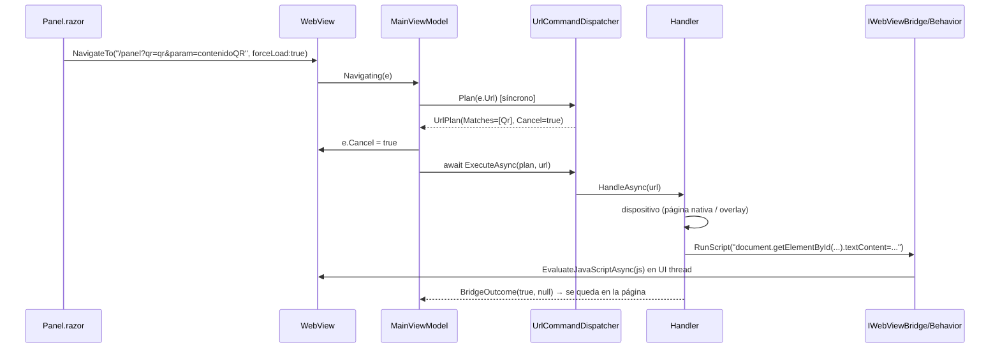

# 08 — App híbrida integrada (WebView + Blazor Server + puente de comandos por URL)

> **Propósito:** destilar cómo funciona la app híbrida de `Ejemplos_Devices/Integrada/`: un `WebView` MAUI que hospeda una web Blazor Interactive Server **remota**, el puente nativo por URL (clasificación síncrona vs ejecución asíncrona, por qué se cancela la navegación), el catálogo de comandos, los dos modos de entrega del GPS, los overlays, cómo vuelve el resultado al DOM, el backend Blazor y la suite xUnit.
> **Fuente primaria:** `Ejemplos_Devices/Integrada/Ejemplo_Maui_Hibrida/**`, `Ejemplos_Devices/Integrada/Ejemplo_Maui_Hibrida.Tests/**`, `Ejemplos_Devices/Integrada/Ejemplo_ws_Blazor/**`, `Ejemplos_Devices/Docs/web-hibrida/*.md` (commit `285f6fb`).
> **Índices relacionados:** [00_MASTER-INDEX](00_MASTER-INDEX.md) · [01_Camara](01_Camara.md) · [02_QR](02_QR.md) · [03_Impresion-Termica](03_Impresion-Termica.md) · [04_GPS](04_GPS.md) · [06_Telefonia](06_Telefonia.md) · [07_Red-Conectividad](07_Red-Conectividad.md) · [09_CI-CD-y-Build](09_CI-CD-y-Build.md) · [10_Documentacion-Transversal](10_Documentacion-Transversal.md)

Rutas relativas a la raíz del repo de código. Abreviaturas: `HIB/` = `Ejemplos_Devices/Integrada/Ejemplo_Maui_Hibrida/`, `TST/` = `Ejemplos_Devices/Integrada/Ejemplo_Maui_Hibrida.Tests/`, `WEB/` = `Ejemplos_Devices/Integrada/Ejemplo_ws_Blazor/`.

---

## 1. Mapa del dominio

| Proyecto | Tipo | TFM | Rol |
|---|---|---|---|
| `Ejemplo_Maui_Hibrida` | App MAUI (`OutputType=Exe`) | `net10.0-android` (+ `net10.0-ios` sólo en macOS) | Contenedor: `WebView` + puente nativo + overlays (`HIB/Ejemplo_Maui_Hibrida.csproj:4-5`) |
| `Ejemplo_Maui_Hibrida.Tests` | xUnit | `net10.0` plano + `UseMaui=true` | Tests de VMs, dispatcher y `GpsCommandHandler` por **linkeo de fuentes** (`TST/Ejemplo_Maui_Hibrida.Tests.csproj:9-10,41-84`) |
| `Ejemplo_ws_Blazor` | ASP.NET Core Web (Blazor Interactive Server + Web API) | `net10.0` | La web que se hospeda (`WEB/Ejemplo_ws_Blazor.csproj:4`); la app la abre en `https://aplicada.somee.com` (`HIB/Pages/MainPage.xaml.cs:17`) |
| `Ejemplo_Docs_Integrada` | Carpeta de docs | — | `Readme.md` **vacío** (0 líneas); la prosa real está en `Ejemplos_Devices/Docs/web-hibrida/` (§13) |

En la solución: carpeta `/Ejemplos/Integrada/` con la app (con `<Deploy/>`) y el Blazor; **el proyecto de tests no está en `Ejemplos_Devices.slnx`** (`Ejemplos_Devices/Ejemplos_Devices.slnx:64-72`) y ningún workflow lo ejecuta (ver [09](09_CI-CD-y-Build.md)).

```
HIB/
├── MauiProgram.cs            ← DI: servicios, VMs, 7 handlers (orden = precedencia), MotorDsl, BarcodeScanning
├── App.xaml(.cs) / AppShell  ← Shell con MainPage + rutas MyMediaPickerPage, MyMediaSelfiePickerPage, QRLectorPage
├── Pages/MainPage.xaml(.cs)  ← WebView + 4 StatusOverlayView + botonera nativa; Url inicial
├── ViewModels/MainViewModel.cs ← intercepta Navigating/Navigated; guard de reentrada
├── LibApp/
│   ├── CustomWebView/        ← IWebViewBridge, WebViewBridge, WebViewBridgeBehavior, converters
│   ├── UrlCommands/          ← IUrlCommandHandler, UrlCommandDispatcher, UrlPlan, BridgeOutcome, CommandDelivery
│   │   └── Handlers/         ← Gps, Call, Camera, Selfie, Qr, SendApi, Print
│   └── Devices/              ← Common, GPS, Phone, Networks, MotorDSL, Camera, Images, QRLector
└── Platforms/                ← AndroidManifest, network_security_config + 3 .pem, Info.plist
```

---

## 2. Arquitectura: dos canales

```
                ┌──────────────── Ejemplo_Maui_Hibrida (MAUI) ────────────────┐
 Usuario ──tap──►  WebView (Source={Binding Url})                              │
                │     │ Canal A: HTML + circuito SignalR ◄───────────────┐     │
                │     │ Canal B: Navigating(e) ─► MainViewModel          │     │
                │     │            Plan(url) [sync] → e.Cancel            │     │
                │     │            ExecuteAsync → handler → servicio/VM   │     │
                │     │            ◄── RunScript(js) (Injection)          │     │
                │     │            ◄── Url = NavigateTo (Substitution)    │     │
                │  StatusOverlayView ×4 (GPS, Red, Llamada, Impresión)    │     │
                └─────────────────────────────────────────────────────────│─────┘
                                                                          │
                ┌──────────── Ejemplo_ws_Blazor (aplicada.somee.com) ─────┴─────┐
                │  /, /datos, /panel, /geolocalizacion, /redirigir (Razor)       │
                │  /api/Tikects/comprobante, /api/GeoReporter/track, /api/pagofake│
                └────────────────────────────────────────────────────────────────┘
```

| Canal | Qué transporta | Mecanismo | Fuente |
|---|---|---|---|
| **A** | Interactividad de la web (`@onclick`) | Blazor Interactive Server: prerender + circuito SignalR (`blazor.web.js`) | `WEB/Program.cs:8,57`; `WEB/Components/App.razor` |
| **B** | Pedidos de capacidades nativas | La web navega a una URL "marcada" con `forceLoad: true`; la app la intercepta en `Navigating`, la cancela y ejecuta un handler | `HIB/ViewModels/MainViewModel.cs:90-133` |

El control es el `WebView` estándar (no `BlazorWebView`): la web es un sitio remoto opaco (`HIB/Pages/MainPage.xaml:27`).

---

## 3. Composición y arranque

### 3.1 `MauiProgram` (`HIB/MauiProgram.cs`)

| Bloque | Registro | Líneas |
|---|---|---|
| Toolkits | `UseMauiCommunityToolkit()`, `...Core()`, `...Camera()` | 43-45 |
| QR | `UseBarcodeScanning()` | 57 |
| Impresión | `AddMotorDslEngine()` + 3 `DeviceProfile` (`thermal_58mm`/32/`escpos-bitmap`, `a4-pdf`/80/`pdf`, `pdf`/48/`pdf`) + `AddMotorDslMaui()` + `AddBluetoothPrinterTransport()` | 61-70 |
| `AddPrintServices` | `IPrinterService→PrinterService`, `PrinterOverlayViewModel` (singletons) | 80-88 |
| Servicios | `IGpsService`, `Connectivity.Current`, `IUiDispatcher→MainThreadDispatcher`, `INetworkService`, `ICallService`, `ApiRelayService` | 93-98 |
| Páginas | `IWebViewBridge→WebViewBridge` (singleton), `IImageService`, `MyMediaPickerPage`/`MyMediaSelfiePickerPage` (transient) | 102-105 |
| VMs | `GpsOverlayViewModel`, `NetworkOverlayViewModel`, `CallOverlayViewModel` (singletons) | 109-111 |
| **Handlers** | 7 × `IUrlCommandHandler` en orden **Gps, Call, Camera, Selfie, Qr, SendApi, Print** + `UrlCommandDispatcher` | 115-123 |
| Main | `MainViewModel`, `MainPage` (singletons) | 127-128 |

> Comentario explícito: «el orden de registro = orden de evaluación» (`HIB/MauiProgram.cs:115`).

### 3.2 Página principal

| Elemento | Detalle | Fuente |
|---|---|---|
| URL inicial | `https://aplicada.somee.com` (alternativas comentadas: geolocate.somee.com, google, devtunnels) | `HIB/Pages/MainPage.xaml.cs:13-17` |
| Inspector iOS | `webView.Inspectable = true` **comentado** | `HIB/Pages/MainPage.xaml.cs:19-22` |
| WebView | Dentro de `RefreshView` (pull-to-refresh); visible **sólo si el overlay de Red está oculto** (`InvertedBoolConverter`) | `HIB/Pages/MainPage.xaml:24-40` |
| Behaviors | `WebViewBridgeBehavior` + 2 `EventToCommandBehavior` (`Navigating`, `Navigated`) con converters | `HIB/Pages/MainPage.xaml:28-38` |
| Overlays | 4 `StatusOverlayView`; el último declarado queda arriba: GPS < Red < Llamada < **Impresión** | `HIB/Pages/MainPage.xaml:42-50` |
| Botonera nativa | Volver · Geo Pos · Llamar · Leer QR | `HIB/Pages/MainPage.xaml:52-57` |

Shell: `MainPage` como contenido + rutas `MyMediaPickerPage`, `MyMediaSelfiePickerPage`, `QRLectorPage` (`HIB/AppShell.xaml.cs:12-14`); `App` crea `new Window(new AppShell())` (`HIB/App.xaml.cs:9-12`).

### 3.3 Stack (`HIB/Ejemplo_Maui_Hibrida.csproj`)

| Paquete | Versión | Línea |
|---|---|---|
| `Microsoft.Maui.Controls` | 10.0.80 | 111 |
| `CommunityToolkit.Maui` / `.Core` / `.Camera` | 14.2.0 / 14.2.0 / 6.1.0 | 104-106 |
| `CommunityToolkit.Mvvm` | 8.4.2 | 107 |
| `BarcodeScanning.Native.Maui` | 3.0.4 | 91 |
| `MetadataExtractor` / `SkiaSharp` | 2.9.0 / 3.119.2 | 99-100 |
| `MotorDsl.*` (Core, Parser, Rendering, Extensions, Printing.Abstractions, Bluetooth, Maui) | 1.0.13 | 116-122 |
| `Microsoft.Extensions.Logging.Debug` | 10.0.9 | 112 |
| `AdamE.Google.iOS.GoogleUtilities` (sólo si `RuntimeIdentifier == iossimulator-x64`) | 8.1.0.3 | 94-96 |

`ApplicationId` `com.ejemplos.devices.integrada.hibrida`, título «Web Hibrida» (`:16-18`); mínimos iOS 15.0 / Android API 25 (`:25-26`); `MauiXamlInflator=SourceGen` (`:14`). Build/firma: ver [09](09_CI-CD-y-Build.md).

---

## 4. El puente de comandos por URL (Canal B)

### 4.1 Piezas

| Pieza | Archivo | Responsabilidad |
|---|---|---|
| `IUrlCommandHandler` | `HIB/LibApp/UrlCommands/IUrlCommandHandler.cs` | `CanHandle(url)` + `HandleAsync(url)`; *default interface members*: `CancelsNavigation => true` (`:22`), `DeliveryFor(url) => None` (`:29`), `OnMatchedSync(url)` no-op (`:41`) |
| `UrlPlan` | `HIB/LibApp/UrlCommands/UrlPlan.cs` | Resultado de **clasificar** una vez: `Matches`, `Cancel`, `Primary` (= primer match), `UrlPlan.Ninguno` |
| `UrlCommandDispatcher` | `HIB/LibApp/UrlCommands/UrlCommandDispatcher.cs` | `Plan(url)` síncrono (`:24-60`); `ExecuteAsync(plan,url)` (`:62-89`); `DispatchAsync(url)` para botones nativos (`:92`); `IsCommand` conservado sólo por firma (`:98`) |
| `BridgeOutcome` | `HIB/LibApp/UrlCommands/BridgeOutcome.cs:5` | `record (bool CancelNavigation, string? NavigateTo = null)` |
| `CommandDelivery` | `HIB/LibApp/UrlCommands/CommandDelivery.cs` | `None` / `Injection` / `Substitution` (§6) |
| `IWebViewBridge` + `WebViewBridge` | `HIB/LibApp/CustomWebView/Behaviors/` | Singleton que sólo dispara eventos `ReloadRequested` / `ScriptRequested` |
| `WebViewBridgeBehavior` | `HIB/LibApp/CustomWebView/Behaviors/WebViewBridgeBehavior.cs` | Única pieza que toca el control: `Reload()` y `EvaluateJavaScriptAsync(js)` en UI thread, fire-and-forget (`:62-64`) |

> ⚠️ Una `Behavior` no está en el árbol visual: su `BindingContext` no se hereda. La behavior lo copia del `WebView` y se suscribe a `BindingContextChanged`; sin eso el binding de `Bridge` queda en `null` **sin error visible** (`WebViewBridgeBehavior.cs:22-26`).

### 4.2 Clasificación vs ejecución: por qué `e.Cancel` es síncrono

`MainViewModel.Navigating` (`HIB/ViewModels/MainViewModel.cs:90-133`) se parte en dos fases:

| Fase | Qué hace | Líneas |
|---|---|---|
| **Síncrona** | `var plan = _dispatcher.Plan(e.Url)`; si `plan.Cancel` → `e.Cancel = true`; si no hay matches → navegación normal, `IsRefreshing=false`, return | 93-106 |
| Guard | Si `plan.Cancel && comandoEnCurso` → descarta el duplicado (ya cancelado) | 108-116 |
| **Asíncrona** | Marca `comandoEnCurso`, `await _dispatcher.ExecuteAsync(plan, e.Url)`; si `outcome.NavigateTo` ≠ null → `Url = outcome.NavigateTo`; `finally` libera flag y `IsRefreshing` | 118-132 |

**Por qué se cancela la navegación:** todos los botones de `Panel.razor` usan `NavigateTo(url, forceLoad: true)` → navegación de documento completa. Si no se cancela, el WebView **recarga** la página: se pierde el elemento DOM donde iría la inyección y se reconecta el circuito. Por eso la decisión de cancelar debe estar **antes del primer `await`** (el WebView lee `e.Cancel` apenas retorna el handler del evento) — regla escrita en `MainViewModel.cs:93-96` y `UrlCommandDispatcher.cs:19-23`.

**Por qué `Plan` existe:** antes `CanHandle` se evaluaba dos veces (en `IsCommand` y en `DispatchAsync`); con handlers con estado daría resultados distintos (`UrlPlan.cs:5-10`). La cancelación pasó de «es comando ⇒ cancelo» a un **OR** de `CancelsNavigation` sobre los que matchean (`UrlCommandDispatcher.cs:36-39`). `OnMatchedSync` corre para **todos** los matches (`:43-44`). Ejecución: *first-match-wins* (`UrlPlan.Primary`).

### 4.3 Reentrada (ADR-0009 D1)

- `[RelayCommand(AllowConcurrentExecutions = true)]` (`MainViewModel.cs:90`): sin esto el `AsyncRelayCommand` queda «en ejecución», `EventToCommandBehavior` no lo invoca en el 2º `Navigating`, `e.Cancel` no se fija y el WebView recarga (`:86-89`).
- `comandoEnCurso` (`:37`) descarta el segundo despacho; sólo aplica a planes que cancelan (`:108-111`).

### 4.4 Invariantes en DEBUG (`Debug.Fail`)

| Dónde | Condición que falla | Significado |
|---|---|---|
| `UrlCommandDispatcher.cs:46-57` (`Plan`) | `cancel && matches[0].CancelsNavigation == false` | URL mal formada: cancela uno, ejecuta otro → navegación muerta |
| `UrlCommandDispatcher.cs:77-86` (`ExecuteAsync`) | `DeliveryFor(url) == Substitution && NavigateTo is null` | Se canceló y no se re-navegó → página congelada |

Sin matches, `ExecuteAsync` devuelve `NavigateTo = null` **a propósito**: devolver la propia URL reasignaba `Url` en toda navegación normal y rompía el cierre del pull-to-refresh (`UrlCommandDispatcher.cs:66-73`).

### 4.5 Secuencia (camino Injection)



---

## 5. Catálogo de comandos

Orden = precedencia (`HIB/MauiProgram.cs:116-122`). Todos usan el default `CancelsNavigation => true`. Detección por `url.Contains(..., OrdinalIgnoreCase)`.

| # | Marcador en la URL | Handler | `param` | Entrega | Dispara | Fuente web |
|---|---|---|---|---|---|---|
| 1 | `coordenadas=coordenadas` | `GpsCommandHandler` | opcional | **Injection** con `param` / **Substitution** sin `param` | `GpsOverlayViewModel.SolicitarGeolocalizacion()` | `Panel.razor:174,181`; botón Geo Pos |
| 2 | `phone=phone` | `CallCommandHandler` | — | None (overlay) | `CallOverlayViewModel.LlamarAsync("3434807427", Direct)` (`CallCommandHandler.cs:11,24`) | `Panel.razor:205,215`; botón Llamar |
| 3 | `photo=photo` | `CameraCommandHandler` | **obligatorio** | Injection (`.src` y `.value`) | `Shell.GoToAsync(MyMediaPickerPage)` + `IImageService` | `Panel.razor:228` |
| 4 | `selfie=selfie` | `SelfieCommandHandler` | **obligatorio** | Injection (`.src` y `.value`) | `Shell.GoToAsync(MyMediaSelfiePickerPage)` | `Panel.razor:252` |
| 5 | `qr=qr` | `QrCommandHandler` | **obligatorio** | Injection (`textContent` = JSON de la lista) | `Navigation.PushAsync(new QRLectorPage())` | `Panel.razor:286`; botón Leer QR |
| 6 | `sendApi=sendApi` (la web escribe `sendAPI`) | `SendApiCommandHandler` | id destino (`?? ""`) | Injection (`textContent` = `{ok,status,body}`) | `ApiRelayService.SendAsync` | `Panel.razor:276` |
| 7 | `action=print` | `PrintCommandHandler` | — | None (overlay) | GET comprobante → `IDocumentEngine.Render` → `PrinterOverlayViewModel.ImprimirAsync` | `Panel.razor:319` |

Parámetros extra de `sendAPI`: `httpMethod` (`Post`|`Get`, otro ⇒ `Blocked`), `url` y `body` url-encoded (`SendApiCommandHandler.cs:29-43,51-56`).

> ⚠️ Sólo **GPS** declara `DeliveryFor`. Los demás quedan en `None` por default aunque inyecten JS: el XML-doc de `CommandDelivery.Injection` los lista como inyección (`CommandDelivery.cs:16-19`), pero la declaración en código no lo refleja. Consecuencia: la aserción de §4.4 sólo vigila a GPS.

> ⚠️ `BridgeOutcome.CancelNavigation` **no lo lee nadie** en producción: la cancelación la decide `UrlPlan.Cancel`. Todos los handlers devuelven `true` (p. ej. `PrintCommandHandler.cs:41-43` dice «sin cancelar navegación» y devuelve `BridgeOutcome(true, null)`); sólo los tests lo consultan.

---

## 6. Cómo vuelve el resultado a la web

### 6.1 Los tres modos (`HIB/LibApp/UrlCommands/CommandDelivery.cs`)

| Modo | Mecanismo | Requisito | Usado por |
|---|---|---|---|
| `None` | Nada vuelve al DOM; el usuario ve el overlay nativo | — | Call, Print |
| `Injection` | `IWebViewBridge.RunScript(js)` sobre la página viva | La navegación **debe** cancelarse (si recarga, el elemento destino desaparece) | Foto, selfie, QR, sendAPI, GPS con `param` |
| `Substitution` | `BridgeOutcome.NavigateTo` = misma URL con el marcador sustituido por valores; `MainViewModel` hace `Url = NavigateTo` | **Invariante:** siempre `NavigateTo` ≠ null, pase lo que pase (`:28-30`) | GPS sin `param` |

Origen declarado del patrón Substitution: `GDA.APP/APPGDA/Services/NotionsLocationsService.cs:139-150` (repo externo, **no verificado**).

### 6.2 GPS: los dos modos (`HIB/LibApp/UrlCommands/Handlers/GpsCommandHandler.cs`)

`DeliveryFor` = `Substitution` si no hay `param`, `Injection` si lo hay (`:41-43`). `HandleAsync` llama primero a `_gps.SolicitarGeolocalizacion()` (overlay busy → resultado) (`:47-48`).

| | **Injection** (`/panel?coordenadas=coordenadas&param=contenidoCoordenada`) | **Substitution** (`/geolocalizacion?coordenadas=coordenadas`, botón Geo Pos) |
|---|---|---|
| Éxito | JS: `var el=document.getElementById(<id>); if(el){el.textContent="Latitud: …, Longitud: …"}` con `JsonSerializer.Serialize` (`:59-66`) | `url.Replace("coordenadas=coordenadas", "Latitud=…&Longitud=…&")` + `"_ts=" + Interlocked.Increment(ref _seq)` (`:86-89`) |
| Fallo | No inyecta; devuelve `(true, null)`; el overlay muestra el error (`:54-55`) | Re-navega **igual** con el centinela `0.0/0.0` (`:79-81`) |
| Decimal | `CultureInfo.InvariantCulture` (`:94`): con `es-*` la coma rompía el parseo (`-31,74 → -3174`, ADR-0009 D2) | Ídem |
| Nonce | — | `_ts=N` fuerza URL distinta: con URL idéntica `WebView.Source` no dispara y no re-navega (`:83-85`) |
| Lectura en la web | `<div id="contenidoCoordenada">` (`Panel.razor:32`) | `[SupplyParameterFromQuery]` en `GeoLocalizacion.razor:21-24` (string; vacío ⇒ `"0.0"`, `:30-34`) o en `Panel.razor:186-189` (double; se muestra sólo si ambos ≠ 0, `:194`) |

Botón nativo **Geo Pos** (`MainViewModel.cs:68-79`): agrega `coordenadas=coordenadas` a la `Url` actual del VM y usa `DispatchAsync`; aplica `NavigateTo`.

### 6.3 Inyecciones concretas (JS emitido)

| Handler | Script | Escapado |
|---|---|---|
| Camera / Selfie | `document.getElementById('{id}').src = '{dataUri}'; document.getElementById('{id}').value = '{dataUri}';` (`CameraCommandHandler.cs:61-64`, `SelfieCommandHandler.cs:58-61`) | Interpolación cruda del id |
| QR | `document.getElementById(<id json>).textContent = <json de List<QRContent>>;` (`QrCommandHandler.cs:46-48`) | `JsonSerializer` en ambos |
| SendApi | `document.getElementById('{callId}').textContent= '{json}';` (`SendApiCommandHandler.cs:76-78`) | JSON envuelto en comillas simples |
| GPS | `if(el){el.textContent=…}` (`GpsCommandHandler.cs:63-65`) | `JsonSerializer` + guard de null |

Foto/selfie: el `dataUri` es `data:image/jpeg;base64,…` tras normalizar con `IImageService.ProcesarPhotoAsync` (EXIF + escalado SkiaSharp, ver [01_Camara](01_Camara.md)); el temporal se borra (`CameraCommandHandler.cs:46-50`). Volver/cancelar ⇒ `(true, null)` sin inyectar.

---

## 7. Detalle de handlers con lógica propia

### 7.1 `PrintCommandHandler` (`HIB/LibApp/UrlCommands/Handlers/PrintCommandHandler.cs`)

```
MostrarObteniendoDocumento()  ─►  GET https://aplicada.somee.com/api/Tikects/comprobante (timeout 30 s)   (:17-18)
   ├─ NetworkError (timeout/excepción)  → MostrarFalloDocumento(PRN-DOC-NET, reintento = este mismo método)  (:59-63)
   ├─ InvalidContract (JSON inválido o Root.Type vacío) → MostrarFalloDocumento(PRN-DOC-CONTRACT) sin reintento (:67-69)
   └─ Ok(json crudo) → DeviceProfile("58HB6", 32, "escpos-bitmap") + capacidades bitmap (320 px, umbral 128) (:75-78)
                     → _engine.Render(json, profile) → _printer.ImprimirAsync(render)  (siempre, aun con render fallido) (:80-86)
```

El JSON se deserializa a `PrintDocument` **sólo para validar** y se pasa crudo a MotorDsl (`:99-111`). ⚠️ El perfil usado (`58HB6`) no es ninguno de los tres registrados en `MauiProgram.cs:64-66`. Motor y transporte: ver [03_Impresion-Termica](03_Impresion-Termica.md).

### 7.2 `SendApiCommandHandler` + `ApiRelayService`

- `ApiRelayService` (`HIB/LibApp/Devices/GPS/ApiRelayService.cs`): allowlist de hosts = **sólo `geolocate.somee.com`** (`:15-18`); URL inválida o host fuera ⇒ `Blocked` sin request; timeout 30 s; body sólo en POST como `application/json` (`:38-39`); status ≥ 400 ⇒ `HttpError`.
- Mapeo a payload `{ok, status, body}` (`SendApiCommandHandler.cs:60-69`): `Success`/`HttpError` con status; `NetworkError`/`Timeout`/`Cancelled`/`Blocked` con status 0 y mensaje en español.

### 7.3 `QrCommandHandler`

`new QRLectorPage()` + `Application.Current.Windows[0].Page.Navigation.PushAsync` y `await destinoPage.ResultadoTask.Task` (`QrCommandHandler.cs:39-41`); la versión por Shell + `OnQrCallback` quedó comentada (`:34-38`). `QRLectorPage` completa `ResultadoTask` una sola vez con `Interlocked` (`HIB/LibApp/Devices/QRLector/Pages/QRLectorPage.xaml.cs:128-134`); símbolos `QRCode,Code39` (`QRLectorPage.xaml:28`). Lector en sí: ver [02_QR](02_QR.md).

---

## 8. Overlays

### 8.1 Base común

`StatusOverlayViewModel` (`HIB/LibApp/Devices/Common/ViewModels/StatusOverlayViewModel.cs`): máquina `OverlayMode {None, Busy, Error}` (`:11`), `ShowBusy(title, subtitle, image)` (`:54-61`), `ShowError(icon, title, message, params OverlayAction[])` (`:64-74`), `Hide()` (`:77`). `OverlayAction(Text, ICommand, Style = Primary)` (`:21`).

`StatusOverlayView.xaml`: capa busy (gif animado + títulos) y capa error (glifo `MaterialIconsOutlined` + botonera por `BindableLayout`); estilo `Secondary` vía `DataTrigger` (`HIB/LibApp/Devices/Common/Controls/StatusOverlayView.xaml:21-56`). ⚠️ «Primary» es simplemente «el DataTrigger de Secondary no disparó» (`PrinterOverlayViewModel.cs:152-157`).

### 8.2 Los cuatro overlays

| VM | Disparo | Busy (gif) | Patrón de fallo | Detalle de dominio |
|---|---|---|---|---|
| `GpsOverlayViewModel` | `GpsCommandHandler` | «Buscando posición GPS» (`satelite.gif`) | `GpsErrorCatalog` (`GPS-*`), éxito ⇒ `Hide()` determinista (Opción A, ADR-0009) | [04_GPS](04_GPS.md) |
| `NetworkOverlayViewModel` | **Reactivo**: `ConnectivityChanged` + `Navigated` | «Reconectando…» (`reconexion.gif`) | `NetworkResult` → pantallas fijas; offline sin «Cerrar» | [07_Red-Conectividad](07_Red-Conectividad.md) |
| `CallOverlayViewModel` | `CallCommandHandler` | «Iniciando llamada» (`timer.gif`) | `CallErrorCatalog` (`TEL-*`) | [06_Telefonia](06_Telefonia.md) |
| `PrinterOverlayViewModel` | `PrintCommandHandler` | varios (`timer.gif`) | `PrinterErrorCatalog` (`PRN-*`), predeterminada/alias/selector | [03_Impresion-Termica](03_Impresion-Termica.md) |

Integración con el WebView:
- **Red** es el único que oculta el WebView (`MainPage.xaml:22-26`) y el único que usa `IUiDispatcher` (el evento llega en hilo del SO) (`NetworkOverlayViewModel.cs:40-43`). `MainViewModel.Navigated` le notifica éxito o fallo (`MainViewModel.cs:135-144`); al recuperar red recarga por `IWebViewBridge.Reload()` sólo si hubo fallo de navegación (`_needsReload`, `NetworkOverlayViewModel.cs:27-29,77-80`).
- Forma común de fallo: `XxxFailure(Code, Title, UserMessage, TechnicalMessage)` con `DisplayMessage = "{UserMessage}\n\n{Code}"`; duplicada **a propósito** en GPS/Phone/MotorDSL (`HIB/LibApp/Devices/GPS/Models/GpsFailure.cs:6-12`).

### 8.3 Catálogos de códigos (contrato con soporte: se agregan, no se renombran)

| Catálogo | Códigos | Fuente |
|---|---|---|
| GPS | `GPS-PERM-ASK`, `GPS-PERM-DENIED`, `GPS-PERM-MDM`, `GPS-OFF`, `GPS-UNSUPPORTED`, `GPS-NO-SIGNAL`, `GPS-CANCELLED`, `GPS-UNKNOWN` | `GPS/Models/GpsErrorCatalog.cs:16-23` |
| Teléfono | `TEL-PERM-ASK`, `TEL-PERM-DENIED`, `TEL-PERM-MDM`, `TEL-UNSUPPORTED`, `TEL-BAD-NUMBER`, `TEL-CANCELLED`, `TEL-NO-ACTIVITY`, `TEL-UNKNOWN` | `Phone/Models/CallFailure.cs:24-31` |
| Impresión | Los 14 `PRN-*` de `Ejemplo_MotorDSL_Dialog`: el archivo es idéntico salvo el `namespace`. Tabla con títulos, mensajes y botonera en [03 §7.2-§7.4](03_Impresion-Termica.md); la híbrida es la única que produce `PRN-DOC-NET` y `PRN-DOC-CONTRACT` (§7.1) | `MotorDSL/Models/PrinterErrorCatalog.cs:20-39` |

(Rutas bajo `HIB/LibApp/Devices/`.) Red no tiene códigos: mensajes fijos en `NetworkOverlayViewModel.cs:105-138`.

---

## 9. Namespaces `LibApp.*`

| Namespace | Contenido | Nota |
|---|---|---|
| `LibApp.CustomWebView.Behaviors` | `IWebViewBridge`, `WebViewBridge`, `WebViewBridgeBehavior` | |
| `LibApp.CustomWebView.Converts` | `WebNavigatingEventArgsConverter`, `WebNavigatedEventArgsConverter` (ambos en un archivo) | |
| `LibApp.UrlCommands` / `.Handlers` | Contrato, plan, dispatcher, enum, 7 handlers | |
| `LibApp.Devices.Common.{Controls,Services,ViewModels}` | `StatusOverlayView`, `IUiDispatcher`/`MainThreadDispatcher`, `StatusOverlayViewModel` | |
| `LibApp.Devices.GPS` (+ `.Models/.Services/.ViewModels`) | `ApiRelayService` en la **raíz** de GPS | ⚠️ el relay REST no es de GPS: vive ahí por ubicación de carpeta |
| `LibApp.Devices.Phone.Models` | `CallResult`, `CallFailure`/`CallErrorCatalog`, `CallMode`, …, **`ApiCallResult`** | ⚠️ `ApiCallResult` (del relay sendAPI) está en el namespace de Phone |
| `LibApp.Devices.Networks.*` | `NetworkResult`, `INetworkService`, `NetworkService`, `NetworkOverlayViewModel` | |
| `LibApp.Devices.MotorDSL.*` | Models, Services, ViewModels, `DTOs.Print` (`N`, `PrintDocument`, `PrintNode`, `PrintStyle`), `DTOs.LocationDto`, `Pages.OverlayBlueToothThermalPrintPage` | `LocationDto` y la página (vacía) no se usan en la app |
| `LibApp.Devices.Camera.Pages`, `LibApp.Devices.Images`, `LibApp.Devices.QRLector.{Models,Pages}` | Páginas de captura; `IImageService`/`ImageDeviceAutoRotateService` + `SelfieMaskDrawable`; lector QR | |

Raíz de la app: `Ejemplo_Maui_Hibrida` (y `.ViewModels`). Los DTO de impresión de la app y del backend son **idénticos salvo namespace** (`LibApp.Devices.MotorDSL.DTOs.Print` vs `Ejemplo_ws_Blazor.DTOs.Print`), réplicas declaradas de `GDA.Core.API.Client` (externo, no verificado).

---

## 10. Backend `Ejemplo_ws_Blazor`

### 10.1 Pipeline (`WEB/Program.cs`)

| Paso | Línea | Nota |
|---|---|---|
| `AddRazorComponents().AddInteractiveServerComponents(DetailedErrors=true)` | 8 | Interactividad por página |
| `AddControllers()`, `AddOpenApi()` | 11, 14 | |
| `ForwardedHeadersOptions` (For/Proto/Host; `KnownNetworks`/`KnownProxies` vaciados) | 21-31 | Para que detrás del proxy de somee se derive `https`/`wss` |
| `MapOpenApi()` + `MapScalarApiReference()` **siempre** (el `if IsDevelopment` está comentado) | 36-42 | `/openapi/v1.json`, `/scalar` |
| `UseStatusCodePagesWithReExecute("/not-found")` | 49 | |
| `UseForwardedHeaders()` → `UseHttpsRedirection()` → `UseAntiforgery()` | 51-54 | |
| `MapStaticAssets()`, `MapRazorComponents<App>().AddInteractiveServerRenderMode()`, `MapControllers()` | 56-60 | |

Paquetes: `Microsoft.AspNetCore.OpenApi` 10.0.8, `Scalar.AspNetCore` 2.14.14; `BlazorDisableThrowNavigationException=true` (`WEB/Ejemplo_ws_Blazor.csproj:7-12`). Perfiles locales `http://localhost:5284` y `https://localhost:8080` (`WEB/Properties/launchSettings.json`).

### 10.2 Páginas

| Ruta | Archivo | Rol |
|---|---|---|
| `/` y `/datos` | `Components/Pages/Datos.razor` | Prueba mínima de interactividad (`InputText` + botón). **Es lo que abre la app al iniciar** |
| `/panel` | `Components/Pages/Panel.razor` | Banco de pruebas del Canal B (§10.3) |
| `/geolocalizacion` | `Components/Pages/GeoLocalizacion.razor` | Destino de Substitution: muestra `{"Latitud": "…", "Longitud": "…"}` |
| `/redirigir` | `Components/Pages/Redirigir.razor` | Reproducción de saltos a Safari en iOS (href, `_blank`, `window.open`, POST cross-origin, `/api/pagofake/*`) |
| `/not-found` | `Components/Pages/NotFound.razor` | Destino de `UseStatusCodePagesWithReExecute` |
| `/Error` | `Components/Pages/Error.razor` | Sin uso activo: el `UseExceptionHandler("/Error")` está comentado (`WEB/Program.cs:43-47`) |

Todas las interactivas usan `@rendermode InteractiveServer` + `[StreamRendering]` (p. ej. `Panel.razor:7`); `App.razor` no fija render mode global. Navegación lateral: Panel, Datos, Redirigir, `pago-fake.html` (`Components/Layout/NavMenu.razor`).

### 10.3 `Panel.razor`: tarjeta → URL → destino DOM

| Tarjeta | Método | URL | Destino |
|---|---|---|---|
| Solicitar coordenadas | `OnSolicitarCoordenadas` | `/geolocalizacion?coordenadas=coordenadas` (`:174`) | Substitution → `GeoLocalizacion.razor` |
| Solicitar GeoPosicion | `OnSolicitarGeoposicion` | `/panel?coordenadas=coordenadas&param=contenidoCoordenada` (`:181`) | `#contenidoCoordenada` (`:32`) |
| LLamar | `OnLLamar` | `/panel?phone=phone` (`:205`) | overlay |
| LLamar y reportar | `OnLLamarYSendAPI` | `phone=phone&sendAPI=sendAPI&httpMethod=Post&url=…` (`:215`) | sólo llamada (first-match-wins; comentado en `:209-211`) |
| Tomar foto | `OnTomarFoto` | `/panel?photo=photo&param=imgFoto1` (`:228`) | `` (`:58`) |
| Tomar selfie | `OnTomarSelfie` | `/panel?selfie=selfie&param=imgSelfie1` (`:252`) | `` (`:76`) |
| Post API | `OnSendAPI` | `sendAPI=sendAPI&httpMethod=Post&url={enc(https://geolocate.somee.com/api/GeoReporter/track)}&param=contenidoSendAPI&body={enc(LocationDto)}` (`:272-276`) | `#contenidoSendAPI` (`:103`) |
| Lectura QR | `OnQR` | `/panel?qr=qr&param=contenidoQR` (`:286`) | `#contenidoQR` (`:114`) |
| Redirigir | `OnRedirect` | `https://www.google.com` (`:296`) | navegación normal (no es comando) |
| Impresión de ticket | `OnImprimirTicker` | `/panel?action=print` (`:319`) | overlay de impresión |
| Prueba de interacción | `OnTest` | — | `DateTime.Now` (sólo Canal A) |

Botones «Mostrar contenido» leen por `eval` `#inputFoto1`/`#inputSelfie1` (`:230-233`, `:254-257`). En `OnAfterRenderAsync(firstRender)` (`:148-165`) muestra coordenadas de query y registra por `eval` el hook `window.recibirRespuestaApi` (`:158-163`).

### 10.4 Controllers y estáticos

| Endpoint | Archivo | Comportamiento |
|---|---|---|
| `GET /api/Tikects/comprobante` | `Controllers/TikectsController.cs:27-44` | `PrintDocument` hardcodeado (datos de negocio simulados, logo PNG 1×1, QR, contenedores anidados) construido con `N.*` (`:51-160`). Lo consume `PrintCommandHandler` |
| `POST /api/GeoReporter/track` | `Controllers/GeoReporterController.cs:17-41` | Recibe `LocationDto`, responde `"{lat}-{lng}"` |
| `POST /api/pagofake/pago` · `GET /api/pagofake/pago-form` | `Controllers/PagoFakeController.cs:10-26` | 302 cross-host a httpbin / HTML con form POST autoenviado (reproduce el «salto a Safari» del pago real) |
| `wwwroot/pago-fake.html` (form autoenviado, enlazado desde `NavMenu`) y `pago-fake-web.html` (botones manuales) | `WEB/wwwroot/` | Variantes estáticas de la misma reproducción |

---

## 11. Configuración por plataforma

| Concern | Android | iOS |
|---|---|---|
| Permisos | `ACCESS_FINE/COARSE_LOCATION`, `ACCESS_NETWORK_STATE`, `CALL_PHONE`, `READ_PHONE_STATE`, `BLUETOOTH*` (legacy y API 31+, `SCAN neverForLocation`), `CAMERA`, `RECORD_AUDIO`, `INTERNET`; `uses-feature gps required=false` (`:34`) (`HIB/Platforms/Android/AndroidManifest.xml:16-62,82-83,92-105`) | `NSCameraUsageDescription`, `NSLocationWhenInUseUsageDescription`, `LSApplicationQueriesSchemes: tel` (`HIB/Platforms/iOS/Info.plist:57-70`) |
| `<queries>` | `DIAL tel`, `REQUEST_ENABLE` (BT), `IMAGE_CAPTURE` (`AndroidManifest.xml:68-89,107-111`) | — |
| Red | `usesCleartextTraffic="true"` + `network_security_config`: base cleartext + anclas extra **sólo** para `aplicada.somee.com` (`isrg_root_x2`, `root_ye`, `ye2` en `res/raw`) (`AndroidManifest.xml:8-9`; `Platforms/Android/Resources/xml/network_security_config.xml`) | Sin `NSAppTransportSecurity` (ATS por defecto) |
| SDK | `minSdk 25`, `targetSdk 36` (`AndroidManifest.xml:114`) | `MinimumOSVersion 15.0` |
| Entitlements | — | `aps-environment development`, `get-task-allow` (ambos plist) |

⚠️ El manifest **repite** bloques de permisos/queries (BLUETOOTH, NETWORK_STATE, FINE/COARSE_LOCATION, REQUEST_ENABLE) (`AndroidManifest.xml:40,57-62,68-76` vs `:92-111`): inocuo; el comentario de `:51-55` declara el bloque BT como «mismo patrón que `Ejemplo_MotorDSL_Dialog`». ⚠️ El texto de ubicación iOS habla de «infracciones de tránsito» (`Info.plist:64`), heredado de otro proyecto. Por qué la cadena ISRG Root X2 exige anclas en Android viejo: ver `Ejemplos_Devices/Docs/Certificados-SSL/` en [10](10_Documentacion-Transversal.md).

---

## 12. Tests xUnit (`Ejemplo_Maui_Hibrida.Tests`)

### 12.1 Cómo compila

- `net10.0` plano (no `-android`) para correr sin emulador (`TST/Ejemplo_Maui_Hibrida.Tests.csproj:4-9`); xunit 2.9.2, `xunit.runner.visualstudio` 2.8.2, Test.Sdk 17.11.1, `CommunityToolkit.Mvvm` 8.4.2, `MotorDsl.Core`/`Printing.Abstractions` 1.0.13 (`:19-29`).
- **Linkeo de fuentes** (no `ProjectReference`): un `net10.0` no puede referenciar un `net10.0-android`, y extraer `LibApp` a librería contradiría ADR-0001 (`:31-40`). Entran: `StatusOverlayViewModel`, todos los `Models/*.cs` de GPS/Phone/Networks/MotorDSL, **sólo las interfaces** de servicio + `IWebViewBridge` + `IUiDispatcher`, los 4 overlay VMs, `UrlCommands/*.cs` por comodín, `GpsCommandHandler` explícito y `MainViewModel` (`:41-84`).
- Dobles a mano en `TST/Fakes/Fakes.cs` (sin librería de mocking): `FakeGpsService`, `FakeCallService`, `FakeNetworkService` (con `EmitirConectividad`), `FakeUiDispatcher` (inline), `FakeWebViewBridge` (cuenta reloads, re-emite scripts), `FakePrinterService`.

### 12.2 Qué cubre (78 métodos: 67 `[Fact]` + 11 `[Theory]`)

| Archivo | # | Foco |
|---|---|---|
| `BaseOverlayTests.cs` | 7 | Máquina None/Busy/Error, botonera no acumula, `Primary` por defecto |
| `GpsOverlayTests.cs` | 11 | Éxito oculta; **no colapsa** la variante (I-5); I-1, I-4; botoneras por causa (permiso, ajustes de ubicación, reintento) |
| `CallOverlayTests.cs` | 7 | I-1, I-3 (no muestra texto de excepción), I-4, reintento reusa número |
| `NetworkOverlayTests.cs` | 9 | Reactivo a conectividad; con página cargada sólo destapa; tras fallo recarga sola; sonda OK recarga |
| `PrinterOverlayTests.cs` | 19 | Única impresora sin preguntar, predeterminada, selector, homónimas por sufijo MAC (sin MAC completa), alias, predeterminada ausente (dos causas, olvidar/emparejar), papel, BT apagado, render fallido, reintento de documento |
| `PrinterErrorCatalogTests.cs` | 11 | Clasificación `PRN-HW-*`, `LINK-LOST`, `TIMEOUT`, `UNKNOWN`; códigos únicos; original conservado |
| `UrlCommandDispatcherTests.cs` | 5 | Plan sin matches, no-cancelable solo, OR de cancelación, `OnMatchedSync` para todos, first-match-wins (**`Skip` en DEBUG** porque dispara `Debug.Fail`, `:79-84`) |
| `NavigatingReentrancyTests.cs` | 3 | ADR-0009 D1: 2º click cancela sin re-despachar; tras completar vuelve a despachar; URL normal no se cancela |
| `GpsCommandHandlerTests.cs` | 6 | Injection con punto decimal bajo `es-AR`; Substitution con `_ts`; nonce distinto; centinela `0.0` sin señal; Injection sin señal no inyecta; `DeliveryFor` por URL |

`Invariantes.cs` hace ejecutables I-1 (`MuestraUnaPantalla`), I-3 (`NoFiltraTextoTecnico`), I-4 (`TieneUnSoloPrimario`) e I-2 (`VariantesDe<T>` por reflexión). I-5 se prueba en `GpsOverlayTests` (no tiene helper). Definición de los cinco: `Analisis/Plan-Armonizacion-Overlays.md` §2 del repo de documentación.

**No cubierto:** handlers Camera/Selfie/Qr/SendApi/Print/Call, `ApiRelayService`, servicios concretos (`GpsService`, `CallService`, `NetworkService`, `PrinterService`), `WebViewBridgeBehavior`, páginas de cámara/QR y todo el backend Blazor. Validación en dispositivo: flujo Maestro en `Utilities/end2end/com.ejemplos.devices.integrada.hibrida.yaml` (ver [09](09_CI-CD-y-Build.md)).

---

## 13. Documentación del dominio y vigencia

| Documento | Cubre | Vigencia frente a `285f6fb` |
|---|---|---|
| `Ejemplos_Devices/Docs/web-hibrida/maui-hibrido.md` | Canal A, Canal B, GPS, asimetría Android/iOS, diagnóstico de iOS no interactivo (§7) | ⚠️ **Desactualizado** en el puente: muestra `IsCommand`/`DispatchAsync` en `Navigating` (`:286-289`), GPS sólo re-navegando (§5.2), `Failure("")` (`:389,405`), lectura `LastKnownLocation` antes de `GetLocationAsync` (`:412,443`; hoy es lectura fresca, `HIB/LibApp/Devices/GPS/Services/GpsService.cs:37-43`), `UseForwardedHeaders` «AUSENTE» (`:219`), catálogo de 6 comandos sin `action=print` (`:302-313`); números de línea viejos (enlaces rotos: [10 §8](10_Documentacion-Transversal.md)) |
| `.../captura-foto.md` | Foto/selfie | §8.1 (input oculto nunca escrito) **sigue vigente**; §8.2 (`param=Selfie1`) **ya corregido** (`param=imgSelfie1`) |
| `.../lectura-qr.md` | QR | §7 («callback `OnQrCallback` nunca se invoca») **superado**: el handler ahora usa `PushAsync` + `ResultadoTask` |
| `.../envio-api.md` | sendAPI | §7.1 (hook `recibirRespuestaApi` inerte) y §7.2 (comillas simples) **siguen vigentes** |
| `.../llamada.md` | Llamada | §6-7 coherentes con el código (combo sólo llama; sin feedback al DOM) |
| `HIB/LibApp/Devices/{Camera,Images,MotorDSL}/README.md` | Guías de registro | ⚠️ `MotorDSL/README.md:34` registra `AddSingleton<PrinterService>()` (el código usa `IPrinterService`) y un solo perfil |

Citas del código del dominio a documentos externos («ADR-0001», «ADR-0009», «Plan 1 §n», `Ejemplos_Maui_Devices.Documentos/Analisis/Plan-Armonizacion-Overlays.md`, `GDA.APP/…`): existencia y nombre correcto verificados en [10 §10](10_Documentacion-Transversal.md); discrepancias de la prosa (D-6, D-7, D-11 a D-14, D-16) en [10 §12](10_Documentacion-Transversal.md).

---

## 14. Trampas y preguntas frecuentes

| # | Pregunta / trampa | Respuesta |
|---|---|---|
| 1 | ¿Por qué la web usa `forceLoad: true`? | Una navegación interna de Blazor (sin recarga) **no** dispara `WebView.Navigating`; con `forceLoad` es navegación de documento y la app la puede interceptar (ADR-0009, contexto) |
| 2 | ¿Por qué no hay `await` antes de `e.Cancel`? | El WebView lee `e.Cancel` al retornar el handler síncrono del evento; ver §4.2 |
| 3 | ⚠️ «Mostrar contenido» de foto/selfie da vacío | Los handlers escriben `.src` **y** `.value` sobre el mismo ``; `#inputFoto1`/`#inputSelfie1` nunca se escriben (`CameraCommandHandler.cs:61-62` vs `Panel.razor:59,77,230-233,254-257`). Los comentarios de clase de los handlers (`CameraCommandHandler.cs:9-10`, `SelfieCommandHandler.cs:8-9`) mencionan un hook `window.recibirFoto` cuya invocación está comentada (`CameraCommandHandler.cs:59`, `SelfieCommandHandler.cs:56`) |
| 4 | ⚠️ QR «Volver» | El comentario dice «Volver o lista vacía = cancelado (no inyecta)» (`QrCommandHandler.cs:11`), pero el código inyecta **siempre**: Volver completa con lista vacía y escribe `"[]"` en el destino (`QRLectorPage.xaml.cs:80-84`, `QrCommandHandler.cs:46-48`) |
| 5 | ⚠️ sendAPI: comentario vs código | El comentario de clase dice `tipoRequest=Post\|Get` y hook `window.recibirRespuestaApi` (`SendApiCommandHandler.cs:10-12`); el código lee `httpMethod` y escribe `textContent` directo. El hook que registra `Panel.razor:158-163` apunta a `#apiOut`, que no existe |
| 6 | ⚠️ sendAPI a `aplicada.somee.com` | Daría `Blocked`: la allowlist sólo tiene `geolocate.somee.com` (`ApiRelayService.cs:15-18`), aunque el mismo backend expone `/api/GeoReporter/track` |
| 7 | ⚠️ Comentario de `OnSolicitarCoordenadas` | Dice que la app «INYECTA en #contenidoCoordenada» (`Panel.razor:172-173`), pero esa URL no lleva `param` ⇒ Substitution hacia `/geolocalizacion` |
| 8 | ⚠️ Cita de línea vieja | `GpsCommandHandler.cs:75` dice que la web interpreta el centinela en `Panel.razor:176`; hoy esa lógica está en `Panel.razor:194` y `GeoLocalizacion.razor:30-34` |
| 9 | ⚠️ `MainViewModel.Url` no sigue la web | `Navigated` no actualiza `Url` (`MainViewModel.cs:135-144`): tras navegar dentro de la web, «Geo Pos» arma la URL sobre la **última asignada por el VM** (al inicio, la raíz → `Datos.razor`, que no muestra coordenadas) y «Volver» puede asignar el mismo valor y **no** re-navegar (mismo fenómeno que motiva el nonce, `GpsCommandHandler.cs:83-85`) |
| 10 | ⚠️ Nonce si el marcador no es el último parámetro | `Replace` deja `…&Longitud=…&` y se concatena `_ts=N` **al final de la URL**: con `?coordenadas=coordenadas&x=1` queda `…&&x=1_ts=1` (`GpsCommandHandler.cs:86-89`). Las URLs actuales lo ponen al final |
| 11 | Reintentar en el overlay GPS ¿entrega el dato? | No: `Reintentar` re-ejecuta `SolicitarGeolocalizacion()` (`GpsOverlayViewModel.cs:108-110`) pero el handler ya devolvió; el resultado no se inyecta ni re-navega |
| 12 | ¿Por qué el combo «Llamar y reportar» no reporta? | First-match-wins y `Call` (2º) precede a `SendApi` (6º) |
| 13 | ¿Qué abre la app al iniciar? | `https://aplicada.somee.com` → ruta `/` = `Datos.razor`, no el panel |
| 14 | ⚠️ Inyecciones frágiles | Camera/Selfie interpolan el id sin escapar y SendApi envuelve JSON en comillas simples: un `'` en el body rompe el JS. QR y GPS usan `JsonSerializer` (seguro) |
| 15 | ¿Una navegación cancelada dispara `Navigated` con error y muestra el overlay de Red? | **No verificado** en código: `Navigated` trata todo resultado ≠ `Success` como fallo (`MainViewModel.cs:140-143`); depende de la plataforma |
| 16 | Diferencias foto vs selfie al volver | Foto anula el callback, navega `..` y recién invoca (`MyMediaPickerPage.xaml.cs:301-304`); selfie invoca y luego navega (`MyMediaSelfiePickerPage.xaml.cs:376-377`). Detalle de cámara: [01_Camara](01_Camara.md) |
| 17 | Código «en construcción» deliberado | `OverlayBlueToothThermalPrintPage` vacía, `LocationDto` sin uso, `OnGenerarTicket() { }` (`Panel.razor:315`), `sytle=` en `#contenidoTicket` (`:136`), `pago-fake-web.html` con botón que apunta a `fpost` cuando ese form está comentado y el vivo es `form1` (`WEB/wwwroot/pago-fake-web.html:9-16`), READMEs vacíos (`LibApp/Devices/README.md`, `Handlers/Readme.md`, `Ejemplo_Docs_Integrada/Readme.md`) |
| 18 | ¿Cómo agrego un comando? | Una clase `IUrlCommandHandler` + una línea en `MauiProgram.AddServices` en la posición de precedencia deseada; si re-navega, declarar `DeliveryFor = Substitution` y devolver siempre `NavigateTo` (`IUrlCommandHandler.cs:3-4`, `CommandDelivery.cs:28-30`) |
| 19 | iOS: la página se ve pero los botones web no responden | Hipótesis documentada (circuito SignalR no se establece en WKWebView) en `maui-hibrido.md` §7; los botones nativos no dependen del circuito. Estado actual en dispositivo: **no verificado** |
| 20 | ⚠️ Las dos tarjetas de GPS se ven iguales | Ambos botones dicen «Tomar Coordenadas» y ambos `<p>` dicen «en una página nueva» (`Panel.razor:18-19,30-31`); sólo el `<h4>` las distingue, y la segunda (Injection) **no** abre página nueva |
