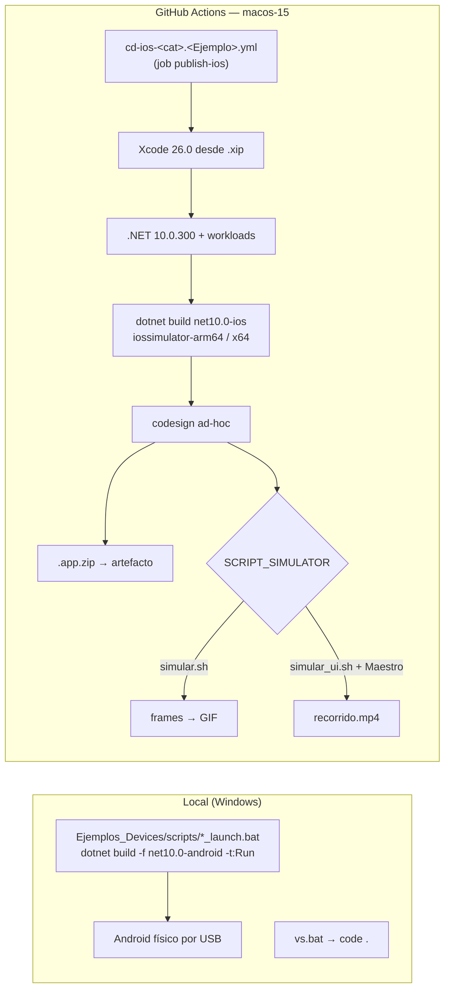

# 09 — CI/CD y build

> **Propósito:** ubicar todo lo que compila, firma, simula y despliega los ejemplos: los 18 workflows `cd-ios-*` (una plantilla y sus variantes), los scripts de simulación y Maestro, los `.bat` de arranque Android, `vs.bat`, el `.slnx` y el `.gitignore`.
> **Fuentes primarias:** `.github/workflows/` (18 `.yml` + `Readme.md` + `Pipelinea-Version.md` + `Analisis/`), `Utilities/`, `Ejemplos_Devices/scripts/`, `vs.bat`, `Ejemplos_Devices/Ejemplos_Devices.slnx`, `.gitignore`. Rutas relativas a la raíz del repo de código. HEAD indexado `cc80ce1` (incluye `85384c2` y `cc80ce1`, que corrigen mayúsculas de rutas en el `.slnx` y en `Docs/web-hibrida/maui-hibrido.md`).
> El porqué está en [ADR-0006](../../Ejemplos_Maui_Devices-docs/docs/04-decisions/0006-ci-ios-adhoc-android-local.md) y [ADR-0007](../../Ejemplos_Maui_Devices-docs/docs/04-decisions/0007-secretos-fuera-del-repo.md); el procedimiento, en el [runbook build-and-run](../../Ejemplos_Maui_Devices-docs/docs/07-operations/build-and-run.md). Este índice dice **dónde** está cada cosa a HEAD.

No existen `Directory.Build.props`/`.targets` ni `global.json` en el repo: la versión de SDK solo se fija en los workflows (§3.1).

---

## 1. Panorama

| Ruta | Plataforma | Dónde | Evidencia que deja |
|---|---|---|---|
| Local | Android (`net10.0-android`) | `Ejemplos_Devices/scripts/*_launch.bat` | app instalada y lanzada en el dispositivo |
| CI | iOS simulador (`net10.0-ios`) | `.github/workflows/cd-ios-*.yml` | `.app.zip` + GIF o MP4 (retención 1 día) |

No hay CI de Android ni build local de iOS (decisión en ADR-0006). Los `.csproj` solo agregan `net10.0-ios` cuando se compila en macOS (p. ej. `Ejemplos_Devices/GPS/Ejemplo_Maui_GPS/Ejemplo_Maui_GPS.csproj:4-5`).

## 2. Inventario de workflows

Todos: un job `publish-ios`, `runs-on: macos-15` (p. ej. `cd-ios-gps.Ejemplo_GPS.yml:50-51`), simulador `iPhone 17 Pro Max`, configuración `Release` salvo excepción (§4).

| Workflow (`.github/workflows/…`) | Proyecto (`PROJECTS_ROOT/PROJECT_NAME`) | `PACKAGE_NAME` | Disparador | RID | Simulación |
|---|---|---|---|---|---|
| `cd-ios-camera.Ejemplo_Photo_MiMediaPicker_Callback.yml` | `Camera/Ejemplo_Photo_MiMediaPicker_Callback` (`:36-39`) | `com.ejemplos.photo.mimediapicker.callback` (`:34`) | `workflow_call` | arm64 | `simular.sh` |
| `cd-ios-camera.Ejemplo_Photo_MiMediaPicker_Callback_Normalizacion.yml` | `Camera/…_Callback_Normalizacion` (`:36-39`) | `com.ejemplos.devices.imagen.callback.normalizacion` (`:34`) | `workflow_call` | arm64 | `simular.sh` |
| `cd-ios-camera.Ejemplo_Photo_MiMediaPicker_Task.yml` | `Camera/Ejemplo_Photo_MiMediaPicker_Task` (`:36-39`) | `com.ejemplos.devices.mimediapicker.task` (`:34`) | `workflow_call` | arm64 | `simular.sh` |
| `cd-ios-camera.Ejemplo_Photo_MiMediaSelfie_Callback_Normalizacion.yml` | `Camera/Ejemplo_Photo_MiMediaSelfie_Callback_Normalizacion` (`:38-41`) | `com.ejemplos.devices.imagen.callback.normalizacion.miselfie` (`:36`) | `workflow_call` | arm64 | `simular.sh` |
| `cd-ios-gps.Ejemplo_GPS.yml` | `GPS/Ejemplo_Maui_GPS` (`:36-39`) | `com.ejemplos.devices.gps` (`:34`) | `workflow_call` | arm64 | `simular.sh` |
| `cd-ios-Integrada.Ejemplo_Maui_Hibrida.yml` | `Integrada/Ejemplo_Maui_Hibrida` (`:38-41`) | `com.ejemplos.devices.integrada.hibrida` (`:36`) | **`push` a `main`** con `paths` del proyecto (`:5-13`) + `workflow_call` (`:15`) | arm64 | **`simular_ui.sh` + Maestro** (`:48-49`) |
| `cd-ios-phone.Ejemplo_Dialer.yml` | `Phone/Ejemplo_Maui_Dialer` (`:36-39`) | `com.ejemplos.phone.dialer` (`:34`) | `workflow_call` | arm64 | `simular.sh` |
| `cd-ios-phone.Ejemplo_DirectCall.yml` | `Phone/Ejemplo_Maui_DirectCall` (`:36-39`) | `com.ejemplos.phone.directcall` (`:34`) | `workflow_call` | arm64 | `simular.sh` |
| `cd-ios-printer.Ejemplo_MotorDSL.yml` | `Printer/Ejemplo_MotorDSL` (`:36-39`) | `com.ejemplos.devices.MotorDSL` (`:34`) | `workflow_call` | arm64 | `simular.sh` |
| `cd-ios-qr.BSM.LectorQR.yml` | `QR/BSM.LectorQR` (`:38-41`) | `…qr.barcodescanner_mobile_maui.simple` (`:36`) | `workflow_call` | **x64** (`:45`) | `simular.sh` (`:48`) |
| `cd-ios-qr.BSM.LectorQR_Dialog.yml` | `QR/BSM.LectorQR_Dialog` (`:38-41`) | `…qr.barcodescanner_mobile_maui.dialog` (`:36`) | `workflow_call` | **x64** (`:45`) | `simular.sh` |
| `cd-ios-qr.BSN.LectorQR.yml` | `QR/BSN.LectorQR` | `…qr.barcodescanner_native_maui.simple` (`:36`) | `workflow_call` | arm64 (`:44`) | `simular.sh` |
| `cd-ios-qr.BSN.LectorQR_Dialog.yml` | `QR/BSN.LectorQR_Dialog` | `…qr.barcodescanner_native_maui.dialog` (`:36`) | `workflow_call` | arm64 | `simular.sh` |
| `cd-ios-qr.CS.LectorQR.yml` | `QR/CS.LectorQR` | `…qr.camerascanner_maui.simple` (`:36`) | `workflow_call` | arm64 | `simular.sh` |
| `cd-ios-qr.CS.LectorQR_Dialog.yml` | `QR/CS.LectorQR_Dialog` | `…qr.camerascanner_maui.dialog` (`:36`) | `workflow_call` | arm64 | `simular.sh` |
| `cd-ios-qr.ZN.LectorQR.yml` | `QR/ZN.LectorQR` | `…qr.zxing_net_maui.simple` (`:36`) | `workflow_call` | arm64 | `simular.sh` |
| `cd-ios-qr.ZN.LectorQR_Dialog.yml` | `QR/ZN.LectorQR_Dialog` | `…qr.zxing_net_maui.dialog` (`:36`) | `workflow_call` | arm64 | `simular.sh` |
| `cd-ios-qr.Ejemplo_LectorQR_Dialog.yml` | `QR/Ejemplo_LectorQR_Dialog` (`:38-41`) — **el proyecto no existe** en `Ejemplos_Devices/QR/` | `com.ejemplos.devices.qr.dialog` (`:36`) | `workflow_call` | arm64 | `./Utils/simular.sh` (`:422-423`) — **ruta inexistente** |

Los `.yml` con `push:` comentado lo tienen en `:5-13` (bloque `branches: main` + `paths` de la carpeta del ejemplo). No hay workflow orquestador que los llame: sin descomentar el `push:`, solo corren por `workflow_call` desde fuera. El `.slnx` lista 18 de los 19 archivos de la carpeta workflows (`Ejemplos_Devices/Ejemplos_Devices.slnx:204-224`); el ausente es `cd-ios-qr.Ejemplo_LectorQR_Dialog.yml`.

## 3. La plantilla (una sola descripción)

Referencia: `cd-ios-gps.Ejemplo_GPS.yml` (437 líneas). Las demás repiten la secuencia con desplazamientos de líneas.

### 3.1 Bloque `env`

| Variable | Valor | Línea |
|---|---|---|
| `XCODE_VERSION` / `_SHORT` | `26.0` (alternativa `26.3` comentada `:18-21`) | `:23-24` |
| `XCODE_FILE_INSTALLER` | `Xcode_26_Universal.xip` | `:25` |
| `XCODE_GOOGLE_FILE_INSTALLER_ID` | id de archivo de Google Drive (no es secreto; ver la línea) | `:26` |
| `DOTNET_VERSION` | `10.0.300` (antes `10.0.102`, comentado `:28`) | `:29` |
| `DOTNET_TARGET_VERSION` | `net10.0` | `:30` |
| `DOTNET_VERSION_WORKLOAD` | `10.0.100` | `:31` |
| `PACKAGE_NAME`, `SOLUTION_FOLDER`, `PROJECTS_ROOT`, `PROJECT_NAME`, `PROJECT_FILE` | datos del proyecto | `:34-39` |
| `RUNTIME_IDENTIFIER_SIMULATOR`, `BUILD_CONFIG_SIMULATOR`, `DEVICE_SIMULATOR` | `iossimulator-arm64`, `Release`, `iPhone 17 Pro Max` | `:42-44` |
| `DOTNET_WORKLOAD_INSTALL_ADDITIONAL_ARGS`, `MD_APPLE_SDK_ROOT` | `--ios-simulator-runtime=26.0`, `/Applications/Xcode_26.0.app` | `:46-47` |

### 3.2 Pasos

| # | Grupo | Qué hace | Líneas (`cd-ios-gps.Ejemplo_GPS.yml`) |
|---|---|---|---|
| 1 | Runner | imprime arquitectura/CPU; `actions/checkout@v4` | `:55-65` |
| 2 | Xcode | `pipx install gdown`; baja el `.xip` de Drive; `xip --expand`; mueve a `/Applications/Xcode_26.0.app`, borra los otros Xcode, `xcode-select --switch`, `-runFirstLaunch`, acepta licencia | `:84-122` |
| 3 | Simulador | `xcrun simctl list runtimes`; `sudo xcodebuild -downloadPlatform iOS`; `simctl boot` del dispositivo | `:133-151` |
| 4 | .NET | borra `~/.dotnet`, instala con `dotnet-install.sh --version 10.0.300`, agrega a `GITHUB_PATH` | `:155-189` |
| 5 | Workloads | `dotnet workload install ios maui maui-ios --version 10.0.100` | `:193-214` |
| 6 | Rutas | exporta `SOLUTION_PATH`, `PROJECT_PATH`, `PLIST_PATH` | `:218-238` |
| 7 | Versionado | lee `CFBundleShortVersionString`/`CFBundleVersion` del `Info.plist` → `APP_VERSION_BUILD`; sello `VERSION_FECHA` | `:242-259` |
| 8 | Manifest | `plutil -lint` del `Info.plist` | `:263-267` |
| 9 | Build | `dotnet clean`; (ApiKeys, §4); `restore` con TFM+RID; `build -c Release -f net10.0-ios -p:RuntimeIdentifier=… -p:LinkMode=SdkOnly -p:EnableCodeSigning=false -p:CodesignKey="-"` con `Entitlements.Development.plist` | `:271-333` |
| 10 | Firma | firma ad-hoc «robusta» (§5) y verificación de entitlements | `:337-380` |
| 11 | Artefacto app | `zip -ry <fecha>_<short>_<build>_<package>.app.zip`; `upload-artifact@v4`, `retention-days: 1` | `:384-403` |
| 12 | Simulación | `brew install ffmpeg`; `Utilities/simular.sh` con `continue-on-error: true`, `timeout-minutes: 30` | `:407-419` |
| 13 | Evidencia | artefacto `grabacion-simulador` (`evidencia_app.gif`, `frames/`, `debug_logs/`, `app_stream_full.txt`, `/tmp/app_stderr.txt`), `retention-days: 1` | `:421-433` |
| 14 | Limpieza | step `Clean up keychain…` (`if: always()`): en esta plantilla solo hace `echo` | `:435-438` |

### 3.3 Por qué se instala Xcode a mano

El runner `macos-15` no garantiza la versión de Xcode que exigen los workloads iOS de .NET 10 (`ios 26.0.11017/10.0.100`, salida pegada en `cd-ios-gps.Ejemplo_GPS.yml:202-207`); por eso el pipeline reemplaza todos los Xcode del runner (`:113`) por un `.xip` fijo bajado de Google Drive. Es la dependencia externa más frágil del CI (si el archivo de Drive cambia de permisos, todos los pipelines caen en el paso 2). Contexto en [build-and-run §Observaciones](../../Ejemplos_Maui_Devices-docs/docs/07-operations/build-and-run.md#observaciones).

## 4. Variantes respecto de la plantilla

| Variante | Workflows | Diferencia | Cita |
|---|---|---|---|
| **ApiKeys activo** | solo `cd-ios-gps.Ejemplo_GPS.yml` | step `PRE-BUILD. Generar ApiKeys.cs desde secreto`: `sed` sobre `Services/ApiKeys.cs.template` con `secrets.GOOGLE_MAPS_API_KEY` | `cd-ios-gps.Ejemplo_GPS.yml:279-285`; plantilla `Ejemplos_Devices/GPS/Ejemplo_Maui_GPS/Services/ApiKeys.cs.template` |
| ApiKeys comentado | 4 camera, 2 phone, printer | mismo step con `#` | p. ej. `cd-ios-phone.Ejemplo_Dialer.yml:279-285` |
| ApiKeys ausente | 9 QR, Integrada | no existe el step | — |
| **Sello `PIPELINE_VERSION`** | 9 QR + Integrada | `202606300809_ejemplos` (mayoría), `202606300822` (`BSM.LectorQR_Dialog`), `202606301040` (`BSN.LectorQR_Dialog`, Integrada) | `cd-ios-qr.*.yml:18`, `cd-ios-Integrada.Ejemplo_Maui_Hibrida.yml:18`; bitácora `.github/workflows/Pipelinea-Version.md:1-15` |
| **x64 + Rosetta** | `BSM.LectorQR`, `BSM.LectorQR_Dialog` | RID `iossimulator-x64`; runtime con `-architectureVariant universal`; step Rosetta condicionado a x64 (presente en todos los QR e Integrada, activo solo en BSM) | `cd-ios-qr.BSM.LectorQR.yml:45,151,424-427` |
| `SCRIPT_SIMULATOR` parametrizado | 9 QR (no el legado), Integrada | el paso de simulación ejecuta `${{ env.SCRIPT_SIMULATOR }}` y copia `/tmp/app_stderr.txt` a `debug_logs/`; en QR queda además el bloque viejo comentado | `cd-ios-qr.BSM.LectorQR.yml:48,435-450` |
| Step `CPY.` comentado | QR, Integrada | copia de recursos, deshabilitada | `cd-ios-qr.BSM.LectorQR.yml:258`, `cd-ios-Integrada.Ejemplo_Maui_Hibrida.yml:265` |
| **`upload-artifact@v5`** | `BSM.LectorQR_Dialog`, `BSN.LectorQR_Dialog`, Integrada | el resto usa `@v4` | `cd-ios-qr.BSM.LectorQR_Dialog.yml:413,454` |
| **Integrada: e2e con Maestro** | `cd-ios-Integrada.Ejemplo_Maui_Hibrida.yml` | `push` activo (`:5-13`); `MAESTRO_VERSION: '1.41.0'` (`:49`); precalienta Simulator.app por GUI antes del boot (`:163-171`); instala Maestro con `get.maestro.mobile.dev` (`:438-443`); corre `simular_ui.sh` (`:445-455`); sube `recorrido.mp4` + `debug_logs/` + `app_stream_full.txt` (`:457-466`); no instala ffmpeg; la limpieza borra un keychain si existe (`:468-473`) | ídem |
| **Configuración vacía** | `cd-ios-qr.BSM.LectorQR.yml` | `BUILD_CONFIG_SIMULATOR` está comentado (`:46`) pero se usa en `-c ${{ env.BUILD_CONFIG_SIMULATOR }}` (`:330`) y en `BASE_PATH` (`:344`) | ver §9 |
| **Legado roto** | `cd-ios-qr.Ejemplo_LectorQR_Dialog.yml` | apunta a un proyecto inexistente y a `./Utils/simular.sh` | `:38-41,422-423` |

La bitácora `Pipelinea-Version.md:2-9` explica el x64: la librería de QR (ML Kit) obliga a referenciar `AdamE.Google.iOS.GoogleUtilities 8.1.0.3` solo con RID `iossimulator-x64`. Justificación larga: `Ejemplos_Devices/Docs/otros/propuesta-rosetta.md`; decisión de preferir BSN: [ADR-0004](../../Ejemplos_Maui_Devices-docs/docs/04-decisions/0004-qr-bsn-recomendada-ios.md).

## 5. Firma

- **Sin certificados ni perfiles de aprovisionamiento.** El build desactiva la firma (`-p:EnableCodeSigning=false -p:CodesignProvision="" -p:CodesignKey="-"`, `cd-ios-gps.Ejemplo_GPS.yml:313-316`) y luego firma **ad-hoc** a mano: `xattr -cr`, borra `_CodeSignature`, firma cada `*.dll`/`*.dylib`/`*.aotdata*`, el binario principal con `Platforms/iOS/Entitlements.Development.plist` y el bundle, todo con `codesign --sign "-"` (`:337-369`).
- **Secretos referenciados en workflows:** únicamente `GOOGLE_MAPS_API_KEY` (activo en GPS, comentado en 7 más). No hay secretos de firma (`P12`, perfiles, keychain): el step `Clean up keychain…` es un resto de plantilla.
- Mecanismo local de la clave: `.gitignore:421` excluye `**/Services/ApiKeys.cs`; se versiona solo `ApiKeys.cs.template`. Decisión: [ADR-0007](../../Ejemplos_Maui_Devices-docs/docs/04-decisions/0007-secretos-fuera-del-repo.md). La clave de Maps hardcodeada fuera de este mecanismo ya está relevada (GAP-REPORT S-01).

## 6. Artefactos

| Artefacto | Nombre | Contenido | Retención |
|---|---|---|---|
| App | `<VERSION_FECHA>_<short>_<build>_<PACKAGE_NAME>.app.zip` | `.app` firmado ad-hoc para simulador | 1 día |
| Evidencia (`simular.sh`) | `grabacion-simulador` | `evidencia_app.gif`, `frames/`, `debug_logs/`, `app_stream_full.txt` | 1 día |
| Evidencia (`simular_ui.sh`) | `grabacion-simulador` | `recorrido.mp4`, `debug_logs/`, `app_stream_full.txt` | 1 día |

No hay `.ipa` ni distribución (TestFlight/tienda): gap declarado en el GAP-REPORT §2.

## 7. Simulación y Maestro (`Utilities/`)

| Archivo | Líneas | Qué hace | Usado por |
|---|---|---|---|
| `Utilities/simular.sh` | 332 | resuelve el UUID del simulador (`:14`), lo bootea con espera, desinstala/instala la app (`:123,140`), concede notificaciones (`:144`), lanza con `--stderr=/tmp/app_stderr.txt` (`:184`), toma screenshots `frames/f<i>.png` (`:209`) y arma `evidencia_app.gif` con `ffmpeg` (`:246-249`) | 16 workflows |
| `Utilities/simular_ui.sh` | 233 | igual arranque, pero graba con `simctl io recordVideo --codec h264` (`:167`) y ejecuta el flujo Maestro `end2end/${PACKAGE_NAME}.yaml` (`:28,177`); si Maestro no está, graba solo el arranque (`:180`). No modifica `simular.sh` (`:6-7`) | Integrada |
| `Utilities/end2end/com.ejemplos.devices.integrada.hibrida.yaml` | 81 | recorrido de la híbrida: `launchApp`, espera activa, toca «Geo Pos», «Llamar», «Leer QR», «Volver» por texto y por coordenada | `simular_ui.sh` vía Integrada |
| `Utilities/end2end/com.ejemplos.devices.gps.yaml` | 35 | flujo «Geo Posicionar / Llamar / Leer QR / back» | **ningún workflow** (GPS usa `simular.sh`) |
| `Utilities/end2end/com.ejemplos.devices.qr.dialog.yaml` | 35 | **idéntico byte a byte** al de GPS | ningún workflow (y su proyecto no existe) |
| `Utilities/download_sectigo.ps1` | 214 | descarga intermedios + raíz (nunca la hoja) del host TLS a `Integrada/Ejemplo_Maui_Hibrida/Platforms/Android/Resources/raw` como `.pem` (`:62,145-169`); el nombre es histórico: la CA real es Let's Encrypt/ISRG (`:2-5`) | manual; ver [ADR-0008](../../Ejemplos_Maui_Devices-docs/docs/04-decisions/0008-trust-anchors-embebidos-webview.md) |

Bitácoras de corridas reales: `.github/workflows/Analisis/log_1.md` (2110 líneas, build x64 del QR legado) y `log_2.md` (102 líneas, paso de simulación con `PIPELINE_VERSION 202606262101`). El diseño de flujos está en el tool-prompt `PROMPTs/Implementaciones/Crear-Flow-End2End-App.md` del repo de documentación.

## 8. Build local y scripts de arranque

| Archivo | Qué hace | Cita |
|---|---|---|
| `Ejemplos_Devices/scripts/Ejemplo_Maui_GPS_launch.bat` | agrega `adb` de `%ProgramFiles(x86)%\Android\android-sdk\platform-tools` al PATH, exige dispositivo conectado y corre `dotnet build <csproj> -f net10.0-android -t:Run` | `:6-7,11-19,30-37` |
| `Ejemplos_Devices/scripts/Ejemplo_Photo_MediaPicker_launch.bat` | idéntico salvo el `.csproj` (`Camera\Ejemplo_Photo_MediaPicker`); el banner sigue diciendo GPS | `:6,23` |
| `Ejemplos_Devices/scripts/GetEnviromentVersion.bat` | `dotnet --version` + `dotnet workload list --verbosity detailed` | `:1-3` |
| `vs.bat` | `code .` (6 bytes, sin salto de línea) | `vs.bat:1` |
| `.github/workflows/Readme.md` | salidas de `dotnet workload` de la máquina local (SDK/workloads `10.0.102`) usadas para configurar los yml | `:1-53` |

Sin `.bat`, cualquier otro proyecto se corre igual: `dotnet build <csproj> -f net10.0-android -t:Run`. Pasos y errores comunes: [build-and-run §Ejecución local](../../Ejemplos_Maui_Devices-docs/docs/07-operations/build-and-run.md#ejecución-local-android-físico); primer arranque: [developer-setup](../../Ejemplos_Maui_Devices-docs/docs/08-onboarding/developer-setup.md).

### 8.1 Proyectos sin pipeline

| Proyecto | En `.slnx` | Motivo visible |
|---|---|---|
| `Camera/Ejemplo_Photo_MediaPicker` | `:37` | solo `.bat` Android |
| `Maps/Ejemplo_Maui_Mapas` | `:74` | — |
| `Printer/Ejemplo_MotorDSL_Dialog`, `Printer/Ejemplo_ThermalPrinter` | `:93,96` | — |
| `Red/Ejemplo_Maui_Connectivity` | `:188` | — |
| `Integrada/Ejemplo_ws_Blazor` | `:68` (sin `<Deploy/>`) | web, no móvil |
| `Integrada/Ejemplo_Maui_Hibrida.Tests` | **no está** en el `.slnx` | ningún workflow ejecuta `dotnet test` |

## 9. Solución `.slnx` y `.gitignore`

`Ejemplos_Devices/Ejemplos_Devices.slnx` (225 líneas): carpetas virtuales `/.Utilities/` (`:2-11`), `/Docs/` (`:12-34`), `/Ejemplos/<Categoría>/` con cada `.csproj` y `<Deploy />` (`:35-194`), `/Ejemplos/Utils/` (`:195-203`) y `/github.workflow/` (`:204-224`). A HEAD, tras `85384c2`:

| Línea | Entrada | Estado |
|---|---|---|
| `:16-18` | `Docs/Certificados-SSL/*` (carpeta virtual `/Docs/certificado-ssl/`) | corregida en `85384c2`; existe |
| `:34` | `/Docs/web-hibrida/` | carpeta **vacía** en el `.slnx`; en disco hay 5 `.md` |
| `:62` | `GPS/Docs_GPS/Readme.md` | **no existe** (la carpeta es `GPS/Ejemplo_Docs_GPS/`) |
| `:111` | `Printer/Ejemplo_Docs_Maps/Borradores/Readme.md` | **no existe** |
| `:101,108` | `Printer/Ejemplo_Docs_Printer/Readme.md` | listado dos veces en carpetas distintas |
| `:85,90` | Ids `016990c8-…-603c` / `…-603d` | GUIDs consecutivos hechos a mano (no es error) |

`.gitignore` (421 líneas): plantilla estándar de Visual Studio (`bin/`, `obj/`, `.vs/`, `*.user`, `*.env`, …) más, al final, `**/Services/ApiKeys.cs` (`:421`).

## 10. Divergencias con la prosa (código a HEAD manda)

| Prosa | Código a HEAD |
|---|---|
| Runbook: «todos declaran únicamente `workflow_call`» y matriz `gps` con `cd-ios-gps.Ejemplo_Maui_Hibrida.yml` | el archivo es `cd-ios-Integrada.Ejemplo_Maui_Hibrida.yml` y tiene `push` activo (`:5-13`); usa Maestro/MP4, no GIF |
| ADR-0006 y runbook: «evidencia GIF» como única | Integrada produce `recorrido.mp4` |
| Runbook: 9 workflows QR funcionales | uno (`Ejemplo_LectorQR_Dialog`) apunta a un proyecto y un script inexistentes |
| Runbook: el paso Xcode usa `cd-ios-qr.CS.LectorQR.yml#L91–L131` como fuente | los números siguen valiendo para QR; en camera/gps/phone/printer el mismo bloque está en `:84-122` |

## Ver también

- [00_MASTER-INDEX](00_MASTER-INDEX.md) · [02_QR](02_QR.md) (BSM/x64) · [08_App-Hibrida-Integrada](08_App-Hibrida-Integrada.md) (app que corre Maestro) · [10_Documentacion-Transversal](10_Documentacion-Transversal.md)
- [ADR-0006](../../Ejemplos_Maui_Devices-docs/docs/04-decisions/0006-ci-ios-adhoc-android-local.md) · [ADR-0007](../../Ejemplos_Maui_Devices-docs/docs/04-decisions/0007-secretos-fuera-del-repo.md) · [ADR-0004](../../Ejemplos_Maui_Devices-docs/docs/04-decisions/0004-qr-bsn-recomendada-ios.md)
- [build-and-run](../../Ejemplos_Maui_Devices-docs/docs/07-operations/build-and-run.md) · [developer-setup](../../Ejemplos_Maui_Devices-docs/docs/08-onboarding/developer-setup.md) · [GAP-REPORT](../../Ejemplos_Maui_Devices-docs/GAP-REPORT.md)
